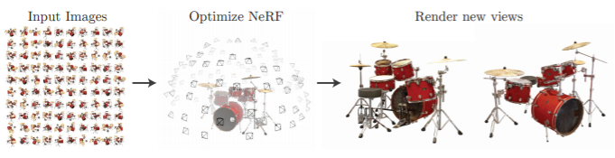
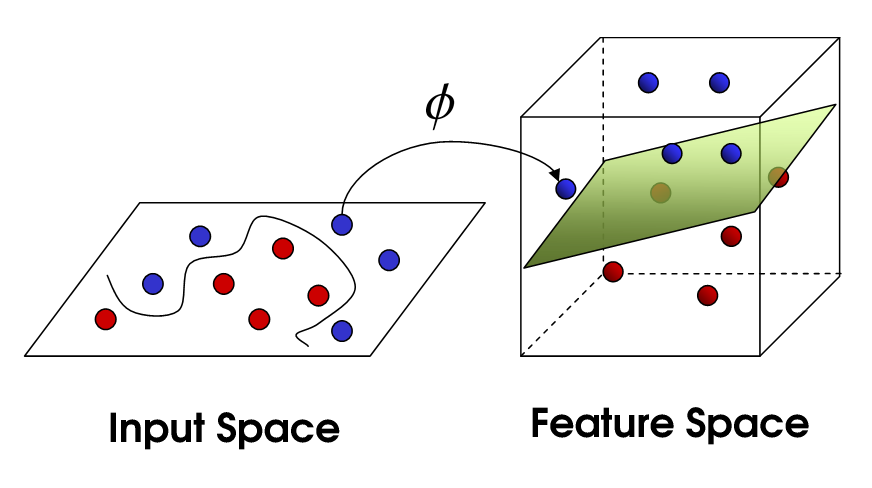
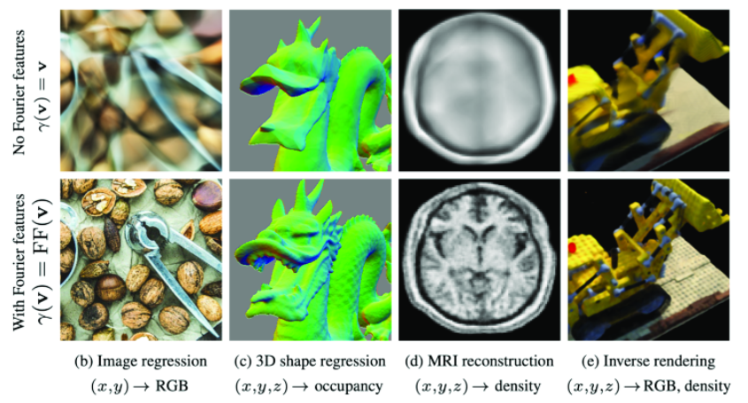
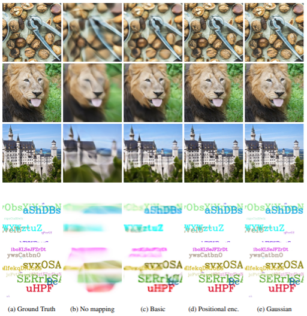

> 이 논문은 Neural Tangent Kernel 을 바탕으로 Fourier-featuring (coordinate space point 의 frequency space 로의 embedding) 이 network 관점에서 stationary 한 (isotrophic) 성질을 갖게 된다는 사실을 수학적으로 규명하고, 이를 통해 3d shape, 2d reconstruction 등의 low-dimension to high-dimension vision task 의 성능을 증대시킬 수 있다는 것을 이론적, 실험적으로 규명한 논문이다.
[NeurIPS2020 Spotlight](https://neurips.cc/virtual/2020/protected/poster_55053683268957697aa39fba6f231c68.html)

## 1. Introduction

Fourier-featuring 이란, ***coordinate space point 를 frequency space 로 embedding 하는 function 의 총칭*** 이다.

Deeplearning model 에서의 대표적인 예시로는, Transformer architecture model 들이 attention 만으로는 원본 위치 정보를 알 수 없으므로, feature 의 위치 정보를 포함시키기 위해 sinusoidal function 을 통해 coordinate space 에서 frequency space 로의 embedding 을 진행하는 **'Positional Encoding'** 등이 있다.

위 논문은 **NTK theory** 를 통해

1. fourier-featuring 을 통해 neural network 가 coordinate information 을 어떻게 받아들이게 되는지 이론적으로 규명하고,
2. 다양한 Vision task 에서 이를 활용한 qualitative case 를 제시하였다.

저자들은 또한 다음 그림과 같이,

- Dense 하고 continuous & uniform 한 low-dimension data input
- high-dimensional output

을 모두 만족하는 neural network를  ***coordinate-based MLP*** 라고 명명한다.
이 논문을 이해하기 위해 kernel trick 과 neural tangent kernel 에 대한 이해가 필요하므로, 간단하게 서술하고 넘어가도록 하겠다.

## 2. Preliminaries

### 2.1. Kernel Trick

Linearly inseparable 한 data point $x$ 에 대하여 $\phi (x)$  (: feature map) 는 linear separability 를 갖게 만드는 non-linear mapping function 이라 하자.

이때 kernel trick 은 이러한 feature map 을 explicit 하게 구하지 않고, kernel 을 통해서 feature space 를 구하는 kernel regression 이며, 다음과 같이 정의한다.
$$K(x, \ x') = \phi(x) ^T \phi(x')
$$

이는 input $x$ 에 feature mapping 을 거친 후에 내적을 취해준다기 보단, kernel 을 통해 좋은 성질을 갖는 feature map $\phi$ 를 구할 수 있다고 해석하는 편이 좋다.

### 2.2. Neural Tangent Kernel (NeurIPS2018)

***Neural tangent kernel*** 은, 이러한 kernel trick 을 이용해 neural network 를 설명하려는 노력의 일환으로, width 가 무한대인 deep한 NN의 GD based training 을 kernel regression 으로 설명하는 이론이다.

#### 2.2.1. Linearization of NN training & Kernel Definition
$$f(w, \ x) \simeq f(w_0 , \ x) \ + \ \nabla _w f( w_0 , \ x) ^T (w - w_0 )
$$

어떠한 neural network model 을 위와 같은 linearization 으로 표현할 수 있다. 이때 Taylor expanded tangent line 은 다음과 같은 성질을 가지는데,

1. weight $w$ 에 대해서 ***linear***
2. $x$ 에 대해서 ***non-linear***

이에 따라 tangent line 의 gradient term $\nabla _w f( w_0 , \ x) ^T (w - w_0 )$ 을 다음과 같이 해석할 수 있다.
- $\nabla _w f( w_0 , \ x) ^T (w - w_0 )$: non-linear data point $x$ 를 어떠한 유용한 space 에 mapping 하는 feature map.

이에 해당하는 kernel $K$ 는 다음과 같이 정의할 수 있다.

$$K(x, \ x') =  h_\text{NTK} = \{ \phi(x) , \ \phi (x') \} = \nabla _w f(w_0 , \ x) ^T \ \nabla _w f(w_0, \ x' )
$$

#### 2.2.2. Gradient-based Training & Kernel Regression
이때, 정의된 neural tangent kernel 을 neural network 의 gradient descent 에서 찾을 수 있다.  timestep $t$ 에 대하여 gradient descent 를 다음과 같이 표현해보자.

$$w(t+1) \ = \ w(t) - \eta \nabla _w l \\ {} \\\rightarrow { w(t+1)  \ - \ w(t) \over \eta } = -\nabla _w l \simeq {dw \over dt}
$$

이제 least square (MSE) 이 loss function 일 때, 다음과 같이 $\nabla _w$ 를 구할 수 있고,

$$l(w) = {1 \over 2}  \| f(w, x ) - y \|^2 \\ \rightarrow \nabla _w l= \nabla _w  |f(w, x) - y |
$$

이에 따라 optimization-based neural network training 을 다음과 같이 NTK kernel regression 으로 나타낼 수 있다.

$$\begin{aligned}
{d \over dt } y(w) &= \nabla _w f(w, x) ^T \cdot {d \over dt }w \\
&= - \nabla _w f(w, x) ^T \cdot \nabla _w f(w, x) (f(w, x) - y) \\ &= -h_{\text{NTK}} (f(w,x) -y )
\end{aligned}$$

이제 $$u=y(w)-y$$ 라고 하자. 이 때, training iteration $t$ 에서의 output residual 을 다음과 같이 표현할 수 있다.

$$ u(t) = u(0) \exp (-\eta h_{\text{NTK}} t )
$$

### 2.3. Spectral Bias of DNNs

이제 논문에서의 Eq.3 을 자세히 살펴보겠다.

위 절에서 살펴 보았던 NTK approximation 에 따라, test data $$\mathbf X_\text{test}$$ 에 대해 $$t$$ iteration 이후의 network 의 prediction 은 다음과 같이 표현할 수 있다.

$$ \hat{\mathbf y}^{(t)} \simeq \mathbf K_\text{test} \mathbf K^{-1} ( \mathbf I - e ^{-\eta \mathbf K t} ) \mathbf y
$$

이상적인 training 에 대해서 $$\mathbf K_\text{test} =  \mathbf K$$ 가 성립할 것이기 때문에, 2.2.2 마지막 eq 의 residual 을 통해 output 을 표현한 것과 같은 형태임을 알 수 있다.

이제 우리는 NTK kernel 를 eigendecomposition 하여 $$\mathbf K = \mathbf Q \mathbf \Lambda \mathbf Q^{\rm T}$$ 로 나타낼 때, 위 식을 다음과 같이 표현할 수 있다.

$$\begin{aligned}
 \mathbf Q^{\rm T} (\hat{\mathbf y} ^{(t)}
 - \mathbf y) &\simeq \mathbf Q ^{\rm T} ( \mathbf K_\text{test} \mathbf K^{-1} ( \mathbf I - e ^{-\eta \mathbf K t} ) \mathbf y - \mathbf y )) \\
& \simeq \mathbf Q ^{\rm T} (  ( \mathbf I - e ^{-\eta \mathbf K t} ) \mathbf y - \mathbf y )) \\
& \simeq - e ^{-\eta \mathbf  \Lambda  t}   \mathbf Q ^{\rm T} \mathbf y \quad (\because e ^{-\eta \mathbf K t} = \mathbf Q e ^{-\eta \mathbf  \Lambda  t} \mathbf Q ^{\rm T} )
\end{aligned}$$

따라서 우리는 exponential 의 지수 항이 eigenvalue 값에 따라 decay 됨을 알 수 있고, 이는 즉 larger eigenvalue 가 먼저 빨리 배우게 됨을 의미한다.

이미지 fourier transform 에서 large eigenvalue 는 전체적인 image 의 contour 등을 담당하고 있으므로, high frequency component 에 대한 convergence 가 느릴 것이다. 이는 NeRF 에서 embedding 을 적용하지 않을 시 fine detail 에 대한 convergence 가 매우 느린 것을 수학적으로 규명한다.

## 3. Fourier Features for a Tunable Stationary Neural Tangent Kernel

이 절에서 저자들은 Fourier Features Embedding 이 Kernel space 상에서 어떠한 역할을 하는지 규명하고, 이를 통해 High frequency component 에 대한 convergence 를 어떻게 효과적으로 다루는지에 대해 설명한다.

### 3.1. Fourier-Feature Mapping & Kernel Regression

#### 3.1.1. Fourier-Feature Mapping
Fourier-Feature mapping function $\gamma$  를 다음과 같이 정의할 수 있다.

$$\gamma (v) \  = \ \big [a_1 \cos (2 \pi b_1 ^T v), \ a_1 \sin (2 \pi b_1 ^T v ), .... , a_m \cos (2 \pi b_m ^T v), \ a_m \sin (2 \pi b_m ^T v ) \big ]^T
$$

- *e.g.* **Positional Encoding in Transformer :**
Transformer 등의 attention-based architecture 에서 ***spatial information 을 feature 에 더해주기 위한 encoding*** 방식이며, 다음과 같이 정의된다.
$$a_i =1, \ b_i = 10000^{i / d} , \ d : \text{dimension}$$

- *e.g.* **Positional Encoding in NeRF :**
Coordinate-based MLP 에서 network input 이 low/high frequency information 을 골고루 잘 포함할 수 있도록 하는 encoding 이며, 다음과 같이 정의된다.
$$a_i =1, \ b_i = 2^{i} {}$$

#### 3.1.2. Kernel Regression to Fourier-Feature mapping
우리는 이 mapping function 으로부터 induced 되는 kernel 을 다음과 같이 정의할 수 있으며, $\cos (\alpha - \beta ) = \cos \alpha \cos \beta  \ + \ \sin \alpha \sin \beta$ 으로부터

$$\begin{aligned}
K (\gamma (v_1 ) , \  \gamma (v_2) ) &= \gamma (v_1 ) ^T \gamma (v_2) \\ &= \sum _{j=1}^m a^2 _j \cos (2 \pi b_j ^T (v_1 -v_2) ) = h_\gamma (v_1 - v_2 )
\end{aligned}$$

fourier featuring kernel 이 2개의 input coordinates 에 대한 stationary function 으로 표현됨을 알 수 있다.

- stationary function 은 ***translation-invariant*** 한 특성을 갖는 function 을 의미한다. 여기서는\
$$h_\gamma( (v_1 +k )  -  (v_2 +k ) ) = h_\gamma (v_1  -  v_2 )
$$
이기 때문에 stationary 한 성질을 만족한다.

Cooridnate-based MLP는 dense & uniform coordinate points 를 입력으로 받아 정보를 추출하는데, global 하게 좋은 성능을 내기 위해서는 *isotropic* 해야한다. 이는 특정 방향이 아닌, 전방위적으로 feature 를 추출해야하기 때문이다.

- 따라서 location 에 상관없이 modeling 을 진행할 수 있는 stationary 성질이 갖춰졌을 때 좋은 성능을 기대할 수 있다.
- 이는 image positional encoding 이 원래 coordinate system 에서 같은 거리만큼 떨어져 있는 관계는 위치 정보에 따른 weight 를 모두 같게 처리하기 때문이며, 좌표의 relative relation 을 high-dimensional space 에서 복각할 수 있다는 것.

### 3.2. NTK Kernel with Fourier-Featuring

이제 NTK fourier-featured kernel 을 다음과 같이 쓸 수 있다.

$$K( \phi \circ \gamma (x) , \ \phi \circ \gamma (y) )
$$

- 여기서 stationary kernel regression 은 ***convolutional filter 를 통한 reconstruction*** 과 같음을 알 수 있다. neural network 가 data point $v_i$  와 이에 대한 weight $w_i$  에서 $K_\text{NTK}$ 와 $K_\gamma$  의 합성 kernel 사이의 convolution 을 approximate 하기 때문.

따라서 NTK theory 을 통해 나타낸 fourier featuring 은 최종적으로 다음과 같다.

$$f = ( h_\text{NTK} \circ h_\gamma ) * \sum_{i=1}^n w_i \delta _{v_i}
$$

여기서 $\delta$ 는 direc delta 이다. 위 식의 의미를 다음과 같이 해석할 수 있다.

1. Stationary 한 filter $h_\gamma$ 를 통해 coordinate system 상에서의 정보를 ***location-invariant*** 하게 추출한다.
2. Convolution 은 frequency space 에서 ***multiplication 의 IFT*** 이기 때문에, $h_\gamma$ 에서 직접적으로 embedding 된 특정 frequency 의 componenet 들을 통해 서로 다른 frequency space 에서의 feature 를 다각도로 (그러나 location invariant 하게) 얻을 수 있다.
3. Fourier-featured input 을 입력받는 NN 은 NTK 와 어떤 stationary kernel 을 합성해서 kernel regression 을 수행하는 것과 같다.

## 4. Experiments

---

원문: [Velog — [Review] Fourier Features Let Networks Learn High-Frequency Functions in Low Dimensional Domains](https://velog.io/@gjghks950/Fourier-Features-Let-Networks-Learn-High-Frequency-Functions-in-Low-Dimensional-Domains-논문-리뷰)
