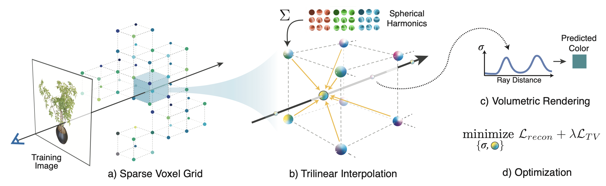
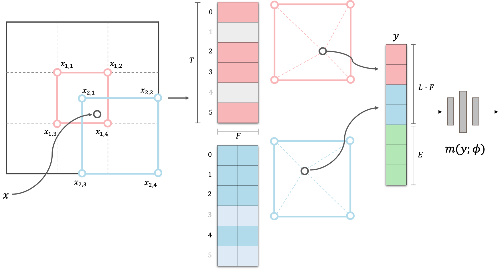

> NeRF 는 그 강력한 성능에 비해 너무나 느린 Training, Rendering 속도 등 여러가지 단점이 있다. 이를 해결하기 위해 Voxel 을 활용하는 연구들이 제시되었지만 속도 향상이 제한적이거나, 성능과의 trade-off 를 겪는 문제점을 보여주었다. Instant-NGP 는 Multi-resolution decomposition 과 Hashing 을 이용하여 극적인 속도 향상과 SOTA performance 를 동시에 달성하였다. 이러한 Instant-NGP 을 리뷰하고, PyTorch 로 핵심 부분을  implementation 을 제공한다.
[SIGGRAPH2022 Best Paper](https://arxiv.org/abs/2201.05989)

## 1. Background
### 1.1. Positional Encoding
NeRF 에서는 high-fidelity Scene reconstruction 을 위해서, 보통 다음과 같은 sinusoidal positional encoding 을 사용한다.
$$ \gamma(p) = \big (\sin(2^0 \pi p), \cos(2^0 \pi p), \dots, \sin(2^{L-1} \pi p), \cos(2^{L-1} \pi p) \big)
$$
[Mip-NeRF](https://velog.io/@gjghks950/Mip-NeRF-A-Multiscale-Representation-for-Anti-Aliasing-Neural-Radiance-Fields-Paper-Review) 의 IPE (Intergrated Positional Encoding) 등과 같이 다른 encoding 을 사용하는 경우도 있지만, 기본적으로 frequency 에 따른 정보를 나누어서 encoding 한다는 사실은 변함이 없다.

하지만 NeRF 는 rendering 과정에서 필요한 모든 점에 대해, 통상 8-layer (w/ 256 or 512 hidden dimension) 의 MLPs inference 가 필요하고, 이는 NeRF 의 느린 속도의 한 원인이 된다.

### 1.2. Voxel-based Method

이러한 단점을 해결하려한 주요 접근방법 중 하나는, 정해진 몇개의 위치에 대한 pre-computing, pre-storing 을 통해서 inference or training 의 computational burden 을 낮추는 것이다.

이는 즉,
1. 3D voxel 상의 vertex 들에 대해서 fixed positional encoding 을 사용하지 않고, learnable paramter 를 도입하여 parametric encoding 을 학습하며,
2. vertex 사이의 점들은 linear interpolation 을 통해 근사함으로써 속도 향상을 일구어냈다.  (그림: [Plenoxels (CVPR2022)](https://alexyu.net/plenoxels/))


하지만 이는 NeRF 에 비해 많은 양의 memory 를 사용해야하며, 복잡한 학습 방법, regularization 등을 고려하여 학습해야 한다는 단점을 지니고 있다.

## 2. Method
### 2.1. Multi-Resolution Hash Encoding

Instant-NGP 는 기존 voxel-based method 와 같이 voxel 의 vertices 에 parametric encoding 을 매핑하는 방법을 사용한다. 하지만 이는 기존 방식과 몇가지 다른 점을 지니고 있다.

**1. Multi-level decomposition**: 전체 scene 을 multi-level 로 나누어 저장하여 각 level 별로 scene geometry 의 다른 부분에 집중할 수 있도록 한다.
**2. Hash Function**: 해상도가 높은 Voxel 일수록 저장해야하는 point 의 수가 size 의 세제곱에 비례하여 늘어나기 때문에, 모든 점에 대한 1:1 저장을 하지 않고 hash function 을 도입하여 필요한 메모리를 줄인다.

다음 그림은 Multi-Resolution Hash Encoding 의 forward 과정에 대한 visualization 이다.



- 그림과 같이 서로 다른 해상도를 가진 level 에 대해서 (Red, Blue), 각 voxel 의 vertex 에는 learnable 한 $F$ dimension 의 feature vector 를 table 에 저장한다. 이 때 table 과 vertex 간의 mapping 은 vertex 좌표에 대한 hashing 으로 정의된다.

- 공간 위의 어떤 한 점에 대해서, 이 점의 encoding 은 점이 속한 hypercube 의 모든 corner vertex feature 간의 linear interpolation 으로 결정되고,

- 이 값이 view-direction encoding 과 합쳐져서 decoding network $m(\mathbf{y}; \phi)$ 에 input 으로 들어가게 된다.

Instant-NGP 는 parametric-encoding 과 multi-level decomposition 능력을 극대화하여, decoding network 는 2-layer w/ 64 hidden dimension 의 극도로 shallow 한 network 를 채택하였다.

이를 통해 point-wise inference 및 convergence 가 다른 NeRF 모델들 대비 극도로 빨라졌으며, SOTA performance 또한 달성하였다.

이후 과정은 다른 NeRF-like model 들과 같이 ray casting 을 이용한 volume rendering 과정을 겪게 된다.


### 2.1. Multi-Level Decomposition

총 $L$ level 에 대하여, level $l$ 에 대한 voxel 의 resolution $N_{l}$ 은 $[\text{N}_\text{min}, \text{N}_\text{max}]$ 사이의 값으로 결정된다. $N_l$ 은 다음과 같이 정의된다.\
$$ b \vcentcolon =
        \exp
        \left(
            \frac{\ln N_{\text{max}} - \ln N_{\text{min}}}{L-1}
        \right)
$$
$$
        N_{l}
        \vcentcolon =
        \lfloor N_{\text{min}} \cdot b^{l-1} \rfloor.
$$

우리는 이제 memory 의 효용성을 위해, 각 $N_{l}$ resolution 의 grid 에 대하여 <span style="color: red">*1:1 대응되는 size*</span> 의 Table 을 선언하는 것이 아닌, <span style="color: red">*고정된 $T$ size*</span> 의 feature Table 을 선언하게 된다. 이 때, grid size 가 $T$ 보다 작은 경우에는 voxel 과 1:1 대응이 되도록 feature Table 을 선언한다. $\big (\text{when }(N_l +1 ) ^d \le T \big )$


위의 과정을 PyTorch 코드로 작성해보면, 다음과 같이 per level scale $b$ 를 계산할 수 있으며,

```python
self.per_level_scale = np.exp2(np.log2(self.N_max / self.N_min) / (self.n_levels - 1))
```
이를 이용해 각 level 별로 voxel size 가 $T$ 보다 작을 때는 voxel size 만큼의 feature table ('grid_size' variable) 을, 클 때는 $T$ size ('hash_size' variable) 의 feature table을 선언하게 된다.

```python
self.one2one = []
self.units = []
for i in range(self.n_levels):
    grid_size = (self.units[i]+1) ** 3
    hash_size = 2 ** self.log2_hashmap_size # T in Eqn
    self.one2one.append(grid_size < hash_size)
    self.units.append(int(np.round(self.N_min * (self.per_level_scale ** i))))

    table_size = (self.one2one[i]) * grid_size + (not self.one2one[i]) * hash_size
    torch_hash = nn.Embedding(int(table_size), self.feat_dim) # self.feat_dim : F in Eqn
    nn.init.uniform_(torch_hash.weight, -self.init_std, self.init_std)

    setattr(self, f'torch_hash_{i}', torch_hash)
```

- 여기서 'self.one2one' array 에는 어떤 level 이 1:1 대응인지,
- 'self.units' 에는 level 별 voxel size 를 저장해 놓았다.


### 2.2. Table Mapping

point $\mathbf{x} \in \mathbb{R}^{d}$ 의 각 level $l$ 에서의 encoding 을 위해, 우선 이 point 는 각 level 의 size 1 hypercube 위로 옮겨지게 된다. 즉,
$$ \mathbf{x}_{l} \vcentcolon = \mathbf{x}_{l} \cdot N_{l}
$$
으로 정의되며, 각각 $\lfloor \mathbf{x}_{l} \rfloor, \ \lceil \mathbf{x}_{l} \rceil$ 을 diagonal vertex 로 갖는 hypercube 에 놓여있게 된다.

이제 이 hypercube는 각 corner vertex 들이 coarse level 일 경우 feature table 과 1:1 대응, dense level 일 경우에는 다음의 hash function 을 이용해서 feature table 로 mapping 된다.

$$ h(x)=
    \left (
        \bigoplus_{i=1}^{d} x_{i} \pi_{i}
    \right )
    \quad \text{mod } T
 $$
 - 여기서 $\pi_i$ 는 큰 소수이며, 논문에서는 순서대로 $[1, 2 654 435 761, 805 459 861]$ 을 사용하였다고 한다.

모든 $2^d$ 개의 vertex 에 대한 feature mapping 이 완료되면, $\mathbf{x}_{l}$ 의 hypercube 내의 상대적 위치를 이용해 각 vertex feature 들을 interpolation 하여 최종적으로 level $l$ 에 대한 encoding 을 얻게 된다.


#### 2.2.1. Hash Grids & Trilinear Interpolation

이제 Instant-NGP 의 forward 에서 $N$ 개의 점을 입력으로 받는다고 가정하자. 일반적인 NeRF dataset 에 대하여 이 점은 3D 이므로 입력의 shape 은 $[N,3]$ 가 될 것이다.

우리의 목표는 points $\mathbf{x}$ 에 대하여 1) 이 point 를 이루는 <span style="color: red">$2^d$ 개의 level 별 corner vertex 좌표</span>와 (*i.e.,* total $l\times 2^d$), 2) 이에 대한 <span style="color: red">level 별 trilinear interpolation weight</span> ($l$) 를 계산하여야 한다.

1. 우선 첫번째로 어떤 level $l$ 에 대하여 points $\mathbf{x}$ 를 level $l$ 의 grid size $N_l$ 인 voxel 위로 span 하고, $[0,0,0]$  부터 $[1,1,1]$ 의 offsets 들을 $\lfloor \mathbf{x}_{l} \rfloor$ 에 더하여 corner vertices 를 계산하자.

```python
corners = []
N_level = self.units[l] # N_min to N_max resolution

for i in range(2 ** x.size(-1)): # for 2^3 corners
    x_l = torch.floor(N_level * x)
    offsets = [int(x) for x in list('{0:03b}'.format(i))]
    for c in range(x.size(-1)):
        x_l[..., c] = x_l[..., c] + offsets[c] # 3-dim (x,y,z)
        corners.append(x_l)
    corners = torch.stack(corners, dim=-2)
```
2. 그 후, corners 와 $\mathbf{x}_l$ 간의 상대적 위치 차이를 이용하여 trilinear weight 를 계산할 수 있다.
```python
# get trilinear weights
x_ = x.unsqueeze(1) * N_level
weights = (1 - torch.abs(x_ - corners)).prod(dim=-1, keepdim=True) + self.eps
```

전체 과정을 함수로 다시 써보면 다음과 같다.

```python
def hash_grids(self, x):
    # input: x [N, 3]
    # output:
    #   level_wise_corners: [L, N, 8, 3]
    #   level_wise_weights: [N, 8, L, 1]

    corners_all = []
    weights_all = []

    for l in range(self.n_levels):
        # get level-wise grid corners
        corners = []
        weights = []

        N_level = self.units[l] # N_min to N_max resolution
        for i in range(2 ** x.size(-1)): # 2^3 corners
            x_l = torch.floor(N_level * x)
            offsets = [int(x) for x in list('{0:03b}'.format(i))]
            for c in range(x.size(-1)):
                x_l[..., c] = x_l[..., c] + offsets[c] # 3-dim (x,y,z)
            corners.append(x_l)
        corners = torch.stack(corners, dim=-2) # [N, 8, 3]

        # get trilinear weights
        x_ = x.unsqueeze(1) * N_level # [N, 1, 3]
        weights = (1 - torch.abs(x_ - corners)).prod(dim=-1, keepdim=True) + self.eps # [N, 8, 1]

        corners_all.append(corners)
        weights_all.append(weights)

    corners_all = torch.stack(corners_all, dim=0) # [L, N, 8, 3]
    weights_all = torch.stack(weights_all, dim=-2) # [N, 8, L, 1]
    weights_all = weights_all / weights_all.sum(dim=-3, keepdim=True)

    return corners_all, weights_all
```

#### 2.2.2. Table Mapping
Table Mapping 에는 1:1 대응인지 아닌지에 따라 방법이 다르므로, **2.1** 에서 선언한 'self.one2one' 을 이용할 것이다.

주의할 점은, 이 함수에는 points $\mathbf{x}$ 가 아닌 이 points 에 대한 <span style="color: red">$l \times 2^d$ 개의 corners</span>  들이 들어가며, 우리는 이를 통해 각 corners 들에 대한 <span style="color: red">table index</span> 값을 output 으로 하는 함수를 작성해야 한다.

1. 1:1 대응일 경우에는 다음과 같이 좌표에 1:1 대응되는 index 값을,
```python
for l in range(self.n_levels):
    ids = []

    c_ = c[l].view(c[l].size(0) * c[l].size(1), c[l].size(2))
    c_ = c_.int()

    if self.one2one[l]: # grid_size << hash_size
        ids = c_[:, 0] + (self.units[l] * c_[:, 1]) + ((self.units[l] ** 2) * c_[:, 2])
        ids %= (self.units[l] ** 3)
```

2. 아닐 경우에는 **2.2** 에서 정의한 hash function 을 통해 index 값을 계산할 수 있다.
```python
# cf. self.primes = [1, 2654435761, 805459861]

else:
    ids = (c_[:, 0] * self.primes[0]) ^ (c_[:, 1] * self.primes[1]) ^ (c_[:, 2] * self.primes[2])
    ids %= (2 ** self.log2_hashmap_size)
```

전체 과정에 대하여 함수로 작성하면 다음과 같을 것이다.

```python
def table_mapping(self, c):
    # input: 8 corners [L, N, 8, 3]
    # output: hash index [L, N * 8]

    ids_all = []
    with torch.no_grad():
        for l in range(self.n_levels):
            ids = []

            c_ = c[l].view(c[l].size(0) * c[l].size(1), c[l].size(2))
            c_ = c_.int()

            if self.one2one[l]: # grid_size << hash_size
                ids = c_[:, 0] + (self.units[l] * c_[:, 1]) + ((self.units[l] ** 2) * c_[:, 2])
                ids %= (self.units[l] ** 3)
            else:
                ids = (c_[:, 0] * self.primes[0]) ^ (c_[:, 1] * self.primes[1]) ^ (c_[:, 2] * self.primes[2])
                ids %= (2 ** self.log2_hashmap_size)
            ids_all.append(ids)

    return ids_all # [L * [N*8]]
```

#### 2.2.3. Multi-Resolution Hash Encoding

이제 우리는 'nn.Embedding' 으로 선언한 각 level 별 feature table feature 값을 indexing 하여, 이를 trilinear interpolation 한 후 level 별로 concat 하여 최종적인 encoding 값을 얻게 된다.
```python
def hash_enc(self, corners, weights):
    # input:    corners [L, N, 8, 3]
    #           weights [L, N, 8, 1]
    # output: interpolated embeddings [N, L*F]

    level_embedd_all = []
    ids_all = self.table_mapping(corners) # [L * [N*8]]

    for l in range(self.n_levels):
        level_embedd = []
        hash_table = (getattr(self, f'torch_hash_{l}'))
        hash_table.to(corners.device)

        level_embedd = hash_table(ids_all[l]) # [N*8, 1] -> [N*8, F]

        level_embedd = level_embedd.view(corners.size(1), corners.size(2), self.feat_dim) # [N, 8, F]
        level_embedd_all.append(level_embedd)

    # Trilinear Interpolation
    # weights: [N, 8, L, 1]
    level_embedd_all = torch.stack(level_embedd_all, dim = -2) # [N, 8, L, F]
    level_embedd_all = torch.sum(weights * level_embedd_all, dim=-3) # [N, L, F]

    return level_embedd_all.reshape(weights.size(0), self.n_levels * self.feat_dim)
```

즉 최종적으로, 우리는 $[N,3]$ 인 input $\mathbf{x}$ 에 대하여,
```python
corners_all, weights_all = self.hash_grids(x)
encodings = self.hash_enc(corners_all, weights_all)
```
으로 multi-resolution hash encoding 결과값을 얻을 수 있다.

## 3. Conclusion
Input dimension size 만 맞춰준다면, 위의 구현은 어떠한 NeRF-like model 의 decoding network 도 호환이 가능하다.

따라서 해당 코드를 이용하여 다른 NeRF 모델과 Multi-Resolution Hash Encoding 의 결합을 손쉽게 구현할 수 있을 것이다.

하지만 위 구현체는 Instant-NGP 에서 보고된만큼 빠르지는 않은데,

1. 우선적으로 CUDA, C++ 로 구현된 original implementation 에 비해 위 구현은 PyTorch 로 이루어졌기 때문에 execution time 에서 손해를 많이 보며,
2. Instant-NGP 는 그 외에도 [tcnn library](https://github.com/NVlabs/tiny-cuda-nn) 를 이용하여 decoding network 를 구현하여 inference 속도를 더 극대화 하였고,
3. Opaque particle 이 없는 hypercube 에 대한 pruning 을 진행하여 inference 효율을 높이는 등

디테일한 추가적인 구현 사항이 필요하기 때문이다.

---

원문: [Velog — Instant-NGP 리뷰 및 구현 (Multi-Resolution Hash Encoding)](https://velog.io/@gjghks950/Instant-NGP-리뷰-및-구현-Multi-Resolution-Hash-Encoding)
