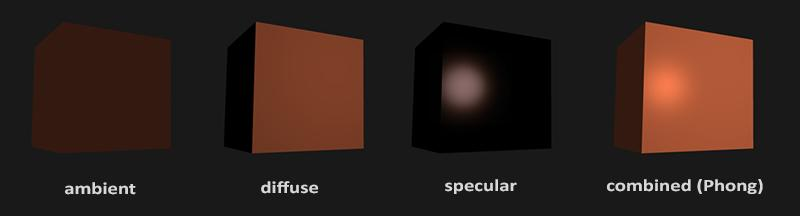
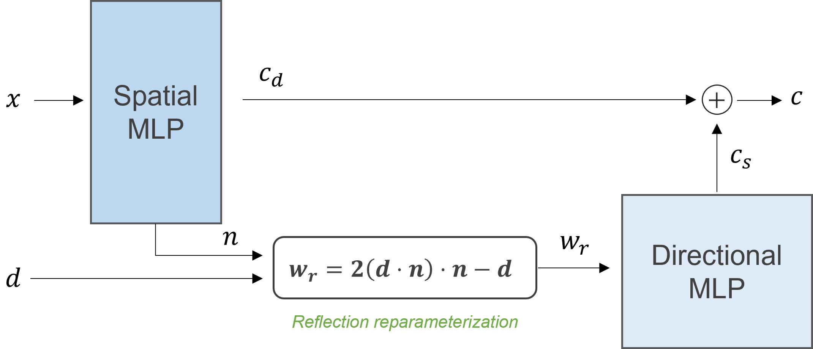
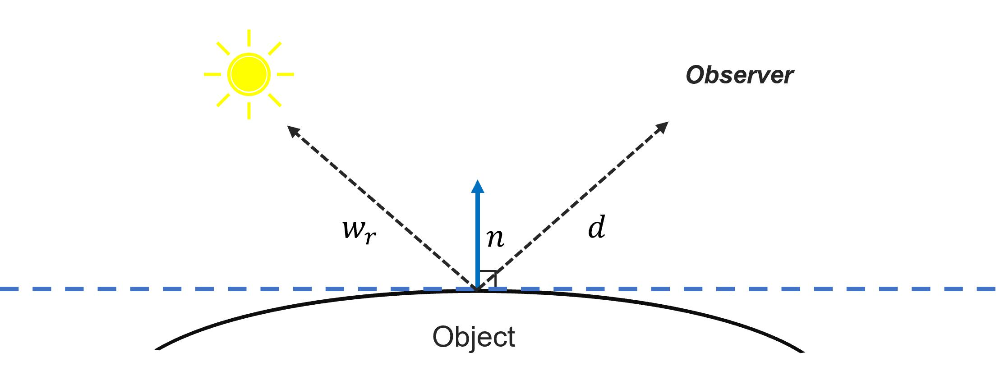
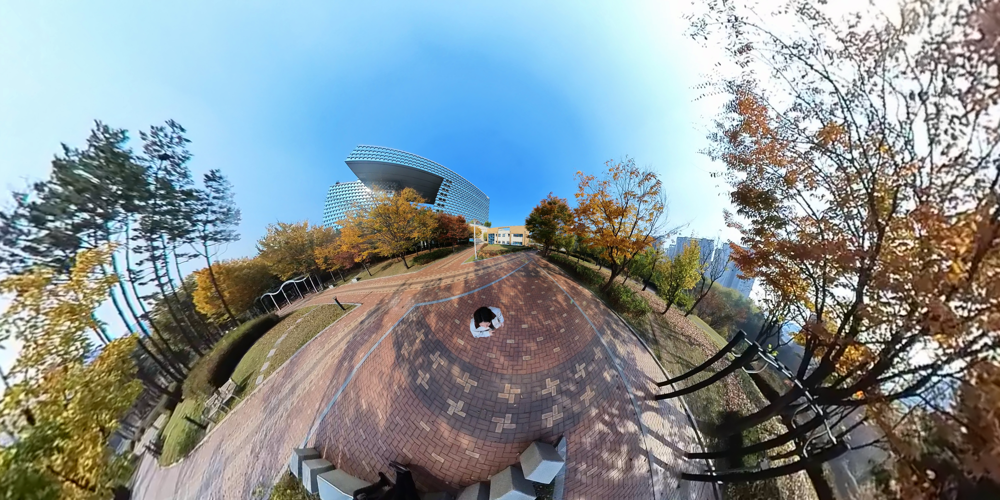

<blockquote>
  
<strong>작성자</strong>

  <ul>
    <li>허환 (Vision AI Lab)</li>
    <li>안녕하세요, AI를 활용한 3D 모델링, 그래픽 기술을 연구하고 있습니다.</li>
  </ul>

  
<strong>이런 분이 읽으면 좋습니다!</strong>

  <ul>
    <li>AI를 활용한 3D 모델링, 그래픽 기술에 관심 있으신 분</li>
    <li>자신이 좋아하는 장소나 물체를 3D AI 기술을 통해 모델링하여 게임 속에서 즐기고 싶으신 분</li>
  </ul>

  
<strong>이 글로 알 수 있는 내용</strong>

  <ul>
    <li>NeRF를 실제로 사용할 때 생기는 문제점과 해결 방안</li>
  </ul>
</blockquote>

## 들어가며

안녕하세요! NC Research Vision AI Lab 허환입니다. 이번 글에서는 <a href="https://ncsoft.github.io/ncresearch/3100003e8ae8576086e5ae2b649f3c3e1863fa91">NeRF로 실감 나는 3D 모델 만들기</a>에 이어, NeRF를 사용하는 데 있어서 생기는 여러 가지 제약 사항들과, 이를 해결하는 방안들을 소개하려고 합니다.

## NeRF를 게임 제작에서 이용할 수 있을까?

<a href="https://ncsoft.github.io/ncresearch/3100003e8ae8576086e5ae2b649f3c3e1863fa91">NeRF로 실감 나는 3D 모델 만들기</a>에서도 소개되었듯이, NeRF는 여러 방향에서 찍힌 이미지 세트로부터 3D 모델을 복원하는 기술입니다. 고품질의 3D 모델을 손쉽게 얻을 수 있기 때문에, 이는 게임 제작 또한 쉽게 해줄 수 있을 매력적인 기술로 보입니다. 그렇다면 과연 NeRF 모델을 곧바로 게임 제작에서 이용할 수 있을까요?

<video class="post-media" controls="" playsinline="" preload="metadata" poster="./assets/diget-poster.jpg" aria-label="과자 박스를 NeRF로 복원한 결과"><source src="./assets/diget.mp4" type="video/mp4"></video>

<em>영상1. NeRF 3D Object 모델링 결과</em>

<em>저번 글에서 보여드린 과자 박스 3D 모델을, 게임에서 오브젝트로 이용할 수 있을까요?</em>

이 질문은 아쉽게도 아직 그 대답이 ‘No’ 입니다. NeRF를 곧바로 상업적인 서비스나 게임 제작 등에서 이용하기엔 아직 극복해야 할 여러 가지 제약 사항들이 많습니다. 이 글에서는 어떠한 제약 사항이 게임 제작이나 기타 서비스에서 NeRF를 바로 사용하기 어렵게 하는지, 그러한 문제들은 어떻게 해결할 수 있는지를 소개하겠습니다.

## 가장 큰 문제, 조명 효과를 분리하지 못하는 NeRF

<video class="post-media" autoplay="" loop="" muted="" playsinline="" preload="metadata" poster="./assets/nerf-poster.jpg" aria-label="조명이 고정된 NeRF 복원 오브젝트"><source src="./assets/nerf.mp4" type="video/mp4"></video>

<em>그림1. NeRF로 생성된 3D Object 들</em>

위 그림은 NeRF로 생성된 3D Object 들의 모습입니다. 꽤 고품질이죠? 하지만 이 3D 모델에는 아주 이질적인 모습이 하나 포함되어 있습니다. 바로

<em>‘오브젝트의 그림자가 고정되어 있다’</em>

라는 점이죠. ‘이게 왜 이상 한거지?’ 라고 생각하실 수도 있겠지만, 지금 이 글을 읽고 있는 공간에서 어떤 물체를 빙글빙글 돌린다고 상상해보세요 (실제로 해보셔도됩니다). 그럼 물체가 돌아가는 방향에 따라 그림자의 방향 또한 바뀌겠죠? 하지만 NeRF 모델의 경우에는, 조명과 물체는 가만히 있고, 관찰자인 내가 물체를 따라 빙글빙글 돌 때 보이는 모습과 일치합니다.

다시 말해 NeRF 모델은 사진에 촬영된 조명의 반사 효과를 물체로부터 분리해낼 수 없습니다. 사실적인 게임 제작의 핵심인 PBR (Physics-Based Rendering)이 relighting을 사실적으로 하는 방법에 초점이 맞춰져 있음을 생각할 때 이는 치명적인 단점입니다.

<em>그림2. Phong Reflection Model, 출처: <a href="https://learnopengl.com/Lighting/Basic-Lighting">OpenGL Basic Lighting</a></em>

가장 단순한 형태의 light shading 중 하나인 Phong shading 에서조차, 물체의 반사 효과는

<ol>
  <li>주변광을 표현하는 Ambient</li>
  <li>난반사를 표현하는 Diffuse</li>
  <li>정반사를 표현하는 Specular</li>
</ol>

3가지로 표현됩니다. 하지만 NeRF로 학습된 모델은 이러한 조명 효과들을 분리해낼 수 없어서, 촬영된 조명 상태가 3D 모델에 그대로 남아 있는 아주 이상한 3D 모델이 됩니다. 최소한의 relighting을 적용하기 위해서는 적어도 물체의 고유한 색에 가까운 diffuse Color를 분리해낼 수 있어야 합니다. 그렇다면, 조명 효과를 분리하여 NeRF를 학습하려면 어떻게 해야 할까요?

## NeRF에서 조명 효과를 분리하려면?

많은 연구자가 다양한 방법들을 소개하고 있지만, 이 글에서는 specular와 diffuse를 분리해서 출력하는 model 구조만으로 조명 효과를 분리하는 방법<a href="#fn:1" class="footnote" rel="footnote">1</a>,<a href="#fn:2" class="footnote" rel="footnote">2</a>을 소개합니다!

일반적인 NeRF Network 구조가 공간의 좌표 \(x\) (spatial location), 관찰 시점 \(d\) (direction)을 입력으로 받아 단일 색상 \(c\) 를 출력하는 것과 달리, diffuse specular 분리를 위한 NeRF 모델은 다음과 같은 구조로 specular color \(c_s\) 와 diffuse color \(c_d\) 를 나누어 출력합니다.

<em>그림3. Diffuse Specular 분리를 위한 NeRF 모델 구조</em>

이때, Spatial MLP는 diffuse color 인 \(c_d\)만을 출력하는 것이 아니라, 해당 위치에서의 법선 벡터인 \(n\) 까지 같이 출력하게 되는데요, 이 법선 벡터는 ‘reflection reparameterization’ 이라는 방법을 통해 반사광을 좀 더 geometry-aware 하게 표현해 줍니다. 결과적으로는 반사광에 대한 파라미터 \(w_r\) 이 Directional MLP에 입력으로 들어가, specular color \(c_s\) 를 출력하게 됩니다.

여기서 사용되는 reflection reparameterization의 수식의 의미가 일견 와 닿지 않을 수도 있는데요, 다음과 같은 상황을 생각해 보면 왜 반사광 \(w_r\) 을 법선 벡터와 관찰 방향을 통해 나타낼 수 있는지 알 수 있습니다.

<em>그림4.  Reflection Reparameterization</em>

위 그림과 같은 상황을 생각해 보면, 오브젝트의 한 지점에서의 반사광 \(w_r\) 은 관찰자의 방향 \(d\) 와 법선 \(n\) 에 대해 다음과 같은 관계를 가지게 됩니다.

\[\frac{(w_{r} + d)}{2}=(d \cdot n) \cdot n\]

이 관계식을 조금 변형하면 앞에서 사용했던 reflection reparameterization을 유도할 수 있게 되는 것이죠! 지금까지 설명한 방법을 사용해서 실제로 조명 효과를 분리해 낸 모습들은 다음과 같습니다.
(Left: Full, Middle: Diffuse, Right: Specular)

<video class="post-media" autoplay="" loop="" muted="" playsinline="" preload="metadata" aria-label="NeRF 장면의 full, diffuse, specular 분리 결과"><source src="./assets/VID_2_illumination_control_scene_watermark.mp4" type="video/mp4"></video>

<em>영상2. Diffuse Specular 가 분리된 NeRF Scene 모델링</em>

<video class="post-media" autoplay="" loop="" muted="" playsinline="" preload="metadata" aria-label="NeRF 오브젝트의 full, diffuse, specular 분리 결과"><source src="./assets/VID_3_illumination_control_object_watermark.mp4" type="video/mp4"></video>

<em>영상3. Diffuse Specular 가 분리된 NeRF Object 모델링</em>

완벽하게 diffuse specular 가 분리되는 모습은 아니지만, 왼쪽의 full NeRF 모델과 비교하면 어느 정도 조명 효과와 독립적으로 물체의 색상을 모델링할 수 있음을 보여줍니다. 가운데 diffuse NeRF 모델만을 사용한다면, relighting을 적용할 수 있게 되겠네요.

## 그 밖의 문제점과 해결 방안들

### 1. NeRF의 느린 속도

NeRF는 3차원 공간 상의 정보를 Neural Network를 통해 저장하고 있기 때문에, 우리가 장면의 정보를 알고 싶다면 반드시 Network (NeRF)를 통과해서 정보를 얻어야 합니다. 아무리 가벼운 Network라 해도, 저장된 정보를 읽어오는 것과 Network를 통해서 정보를 얻는 것은 그 속도 차이가 매우 큽니다.  이는 NeRF의 가장 큰 단점이었던 ‘느린 렌더링 속도’ 와도 직결됩니다.

하지만 이러한 단점은 3차원 일부 위치에만 feature를 저장하고, 나머지 부분은 interpolation을 이용해서 계산량을 줄이는 방식들이 (e.g., Instant-NGP<a href="#fn:3" class="footnote" rel="footnote">3</a> , Plenoxels<a href="#fn:4" class="footnote" rel="footnote">4</a> , TriMipRF<a href="#fn:5" class="footnote" rel="footnote">5</a> , and Zip-NeRF<a href="#fn:6" class="footnote" rel="footnote">6</a> ) 소개되면서 많이 해결되고 있습니다. NeRF와는 다른 기술이지만 최근에는 Gaussian Splatting<a href="#fn:7" class="footnote" rel="footnote">7</a>  이라는 기술도 등장하면서 Neural Rendering에서 real-time을 달성하는데 더 박차를 가하고 있죠.

### 2. 촬영 위치 계산을 위한 전처리

또한 NeRF 모델을 학습하기 위해서는 학습에 사용될 각 이미지의 3차원 상에서의 정확한 촬영 위치를 알아야 합니다. LiDAR 센서 등 하드웨어의 도움을 받기도 하지만, 일반적인 상황에서는 촬영된 사진들의 모습을 3차원상에서 짜 맞추는 Structure-from-Motion이라는 기법을 이용합니다. 하지만 이 방법은 사진의 왜곡에 강인하지 않고, 사진이 많아질수록 그 시간이 기하급수적으로 증가한다는 문제점이 있습니다.

하지만 최근에는 NeRF를 학습하면서 카메라의 위치나 회전 등, 카메라에 대한 정보를 learnable parameter로 같이 학습하는 연구와 (BARF<a href="#fn:8" class="footnote" rel="footnote">8</a>), NeRF 가속화와 카메라 파라미터 학습을 한꺼번에 해결하는 방법 (Instant-Pose<a href="#fn:9" class="footnote" rel="footnote">9</a> ) 등이 제시되면서, 카메라 촬영 위치를 계산에서 발생하는 문제점도 점차 해결되고 있는 모습입니다.

## 게임 엔진에서 사용해 본 Neural Rendering

NeRF와 Neural Rendering 기술 발전 초기에는, 앞서 말씀드린 여러 가지 제약 사항 때문에 게임 제작이나 여타 다른 서비스에서 NeRF를 적극적으로 사용할 수 없었습니다. 하지만 앞서 소개했듯이 이러한 문제들은 점차 해결되는 추세이고, Neural Rendering 기술을 상용 게임 엔진에서 활용할 수 있는 plug-in 들도 속속들이 등장하고 있습니다. <a href="https://ncsoft.github.io/ncresearch/3100003e8ae8576086e5ae2b649f3c3e1863fa91">NeRF로 실감 나는 3D 모델 만들기</a>에서 소개했듯이, 이를 타겟으로 하는 기술 스타트업도 등장하고 있죠.

<video class="post-media" controls="" playsinline="" preload="metadata" poster="./assets/VID_4_NeRF_obeject_in_blender-poster.jpg" aria-label="Blender에서 사용한 NeRF 복원 오브젝트"><source src="./assets/VID_4_NeRF_obeject_in_blender.mp4" type="video/mp4"></video>

<em>영상4. NeRF Object in Blender</em>

위 영상은 NeRF로 복원된 object를 그래픽스 소프트웨어를 이용해 다른 3D object 와 함께 사용해 본 예시입니다. 영상에서 테이블은 NeRF를 통해 복원된 object이고, 공룡과 나비는 미리 정의된 프리셋을 이용한 거죠.

그뿐만 아니라, NeRF와 Neural Rendering 기술을 이용하면 단순히 object를 복원해서 사용하는 것에 그치지 않고, 현실 속 큰 공간을 Neural Rendering 기술을 이용해 복원한 뒤, 이를 게임 속 맵처럼 이용할 수도 있습니다.

<em>그림5.  360 camera capture</em>

<iframe width="100%" src="https://www.youtube.com/embed/ISm-IL3HzmM" title="YouTube video player" frameborder="0" allow="accelerometer; autoplay; clipboard-write; encrypted-media; gyroscope; picture-in-picture; web-share" allowfullscreen="" loading="lazy" referrerpolicy="strict-origin-when-cross-origin"></iframe>

<em>영상5. Reconstructed 3D w/ 360 captures</em>

<iframe width="100%" src="https://www.youtube.com/embed/3OqbvUaoNFw" title="YouTube video player" frameborder="0" allow="accelerometer; autoplay; clipboard-write; encrypted-media; gyroscope; picture-in-picture; web-share" allowfullscreen="" loading="lazy" referrerpolicy="strict-origin-when-cross-origin"></iframe>

<em>영상6. Unity 3D Game w/ Neural Rendering</em>

위 영상은 엔씨 R&amp;D센터 뒤뜰 화랑 공원을 직접 촬영하고, 이를 3D 공간으로 복원하여 게임 속에서 이용해 본 예시입니다. 공간을 효율적으로 촬영하기 위해, &lt;그림5&gt;와 같이 넓은 화각의 특수한 카메라로 360도 공간 전체를 스캔한 뒤, &lt;영상5&gt;처럼 Neural Rendering 기술을 이용해 복원한 것이죠. 단순히 찍힌 그대로를 복원하는 것뿐만 아니라, &lt;영상6&gt; 후반부의 독특한 분위기를 지닌 게임 속 환경처럼 활용해 볼 수도 있습니다. 좋은 아이디어가 합쳐지면 Neural Rendering 기술을 기반으로 하는 멋진 게임들도 많이 나올 수 있지 않을까 기대해 봅니다.

## 마치며

이처럼 NeRF와 Neural Rendering 기술은 급속도로 발전하고 있으며, 관련 기술을 사용한 여러 가지 아이디어도 지속해서 나올 것이라고 예상합니다. 엔씨에서도 최근 주목받고 있는 2D Stable Diffusion 기술을 넘어, Neural Rendering 기술을 통해 게임 제작 환경을 혁신하고자 하는 목표로 다양한 방향에서 연구를 진행해 나가고 있습니다. 앞으로도 저희 팀의 연구 및 개발기와 저희가 눈여겨보고 있는 기술들에 대해서도 소개할 수 있었으면 좋겠습니다. Neural Rendering 분야에서 NC Research의 행보도 관심 있게 살펴 봐주세요! 이것으로 길었던 NeRF 시리즈 글을 마칩니다.

#### Reference

  <ol>
    <li id="fn:1" role="doc-endnote">
      
<a href="https://dorverbin.github.io/refnerf/">Verbin et al. Ref-NeRF: Structured View-Dependent Appearance for Neural Radiance Fields</a>&nbsp;<a href="#fnref:1" class="reversefootnote" role="doc-backlink">↩</a>

    </li>
    <li id="fn:2" role="doc-endnote">
      
<a href="https://bakedsdf.github.io/">Yariv et al. BakedSDF: Meshing Neural SDFs for Real-Time View Synthesis</a>&nbsp;<a href="#fnref:2" class="reversefootnote" role="doc-backlink">↩</a>

    </li>
    <li id="fn:3" role="doc-endnote">
      
<a href="https://nvlabs.github.io/instant-ngp/">Muller et al. Instant Neural Graphics Primitives with a Multiresolution Hash Encoding</a>&nbsp;<a href="#fnref:3" class="reversefootnote" role="doc-backlink">↩</a>

    </li>
    <li id="fn:4" role="doc-endnote">
      
<a href="https://alexyu.net/plenoxels/">Fridovich-Keil et al. Plenoxels: Radiance Fields without Neural Networks</a>&nbsp;<a href="#fnref:4" class="reversefootnote" role="doc-backlink">↩</a>

    </li>
    <li id="fn:5" role="doc-endnote">
      
<a href="https://wbhu.github.io/projects/Tri-MipRF/">Hu et al. Tri-MipRF: Tri-Mip Representation for Efficient Anti-Aliasing Neural Radiance Fields</a>&nbsp;<a href="#fnref:5" class="reversefootnote" role="doc-backlink">↩</a>

    </li>
    <li id="fn:6" role="doc-endnote">
      
<a href="https://jonbarron.info/zipnerf/">Baron et al. Zip-NeRF: Anti-Aliased Grid-Based Neural Radiance Fields</a>&nbsp;<a href="#fnref:6" class="reversefootnote" role="doc-backlink">↩</a>

    </li>
    <li id="fn:7" role="doc-endnote">
      
<a href="https://repo-sam.inria.fr/fungraph/3d-gaussian-splatting/">Kerbl et al. 3D Gaussian Splatting for Real-Time Radiance Field Rendering</a>&nbsp;<a href="#fnref:7" class="reversefootnote" role="doc-backlink">↩</a>

    </li>
    <li id="fn:8" role="doc-endnote">
      
<a href="https://chenhsuanlin.bitbucket.io/bundle-adjusting-NeRF/">Lin et al. BARF: Bundle-Adjusting Neural Radiance Fields</a>&nbsp;<a href="#fnref:8" class="reversefootnote" role="doc-backlink">↩</a>

    </li>
    <li id="fn:9" role="doc-endnote">
      
<a href="https://arxiv.org/abs/2302.01571">Heo et al. Robust Camera Pose Refinement for Multi-Resolution Hash Encoding</a>&nbsp;<a href="#fnref:9" class="reversefootnote" role="doc-backlink">↩</a>

    </li>
  </ol>

원문: [NC Research — NeRF를 게임 제작에서 이용할 수 있을까?](https://ncsoft.github.io/ncresearch/b515d0241ebe9af4a549e991ae0efc4a90f0f65e)
