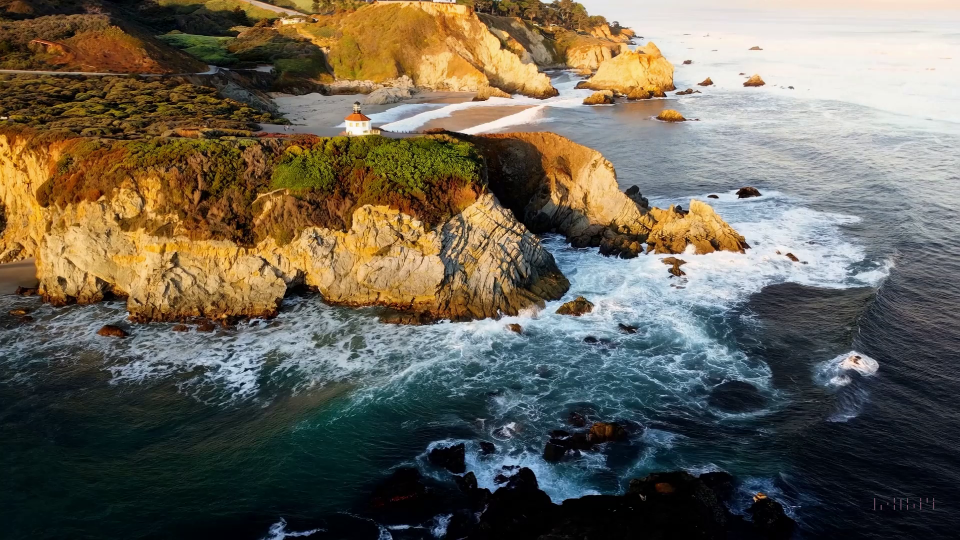
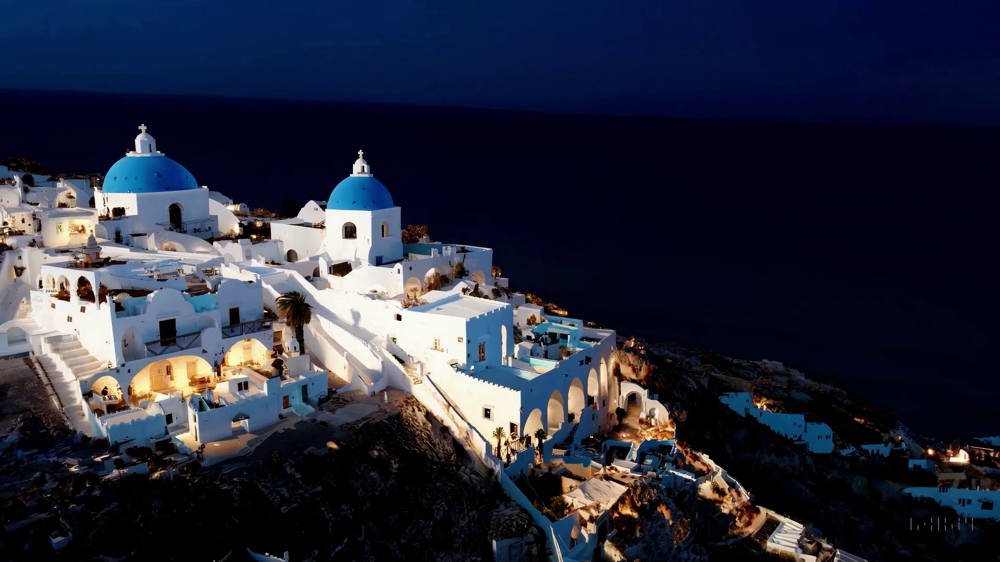
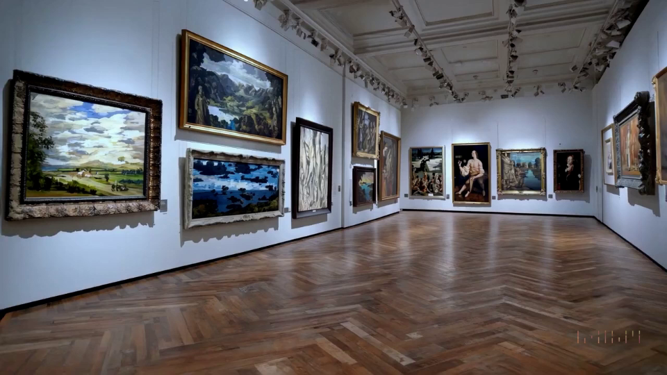
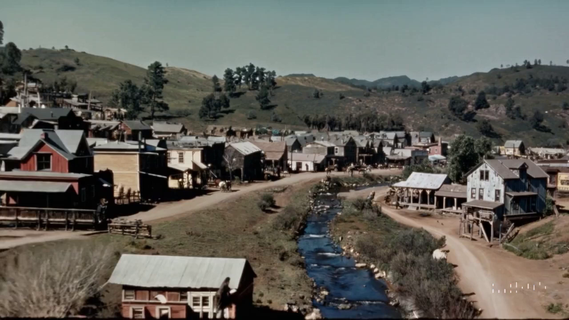

- 최근 OpenAI 에서 발표된 Video Generation AI [Sora](https://openai.com/sora) 의 결과 동영상을 이용해 Neural Rendering (NeRF/3D Gaussian Splatting) 으로 3D reconstruction 을 진행해보고, 이에 대한 고찰을 몇 개 남긴다.

## 들어가며
Sora는 ChatGPT 이후로 나온 가장 충격적인 성능의 AI 모델이 아닐까 싶다. Machine Learning 분야에서 curse of dimensionality 를 해결하는 것은 그리 간단한 일이 아니기 때문에, 나는 Video Generation 이 2D image diffusion 만큼의 성능을 내는 것은 시간이 필요한 일이라고 생각했었다.

그런 내 생각을 무참히 부정해버리는 연구가 2024년 초부터 등장한다.

    <iframe width="100%" title="Sora 영상 예시" loading="lazy" referrerpolicy="strict-origin-when-cross-origin" src="https://www.youtube.com/embed/HK6y8DAPN_0?si=86HWbOrGACbYvlEe&amp;start=82" frameborder="0" allow="accelerometer; autoplay; clipboard-write; encrypted-media; gyroscope; picture-in-picture; web-share" allowfullscreen></iframe>

- ***Prompt***: *A movie trailer featuring the adventures of the 30 year old space man wearing a red wool knitted motorcycle helmet, blue sky, salt desert, cinematic style, shot on 35mm film. [(VidLink)](https://cdn.openai.com/sora/videos/mitten-astronaut.mp4)*

당장 1 frame 간격의 consistency 도 유지하기 힘들어하는 기존 video generation 결과에 비해, 정말 월등한 생성 성능이다.

3D Reconstruction 이 연구 분야인 나는, sora 가 과연 geometric consistency 도 이해하면서 장면을 생성하고 있을지, 아니면 아직은 content 에 대한 consistency 만 유지하고 있을지 궁금해졌다. 따라서 다음과 같은 가정을 통해서 가설을 검정하고, 이에 대한 내 생각을 남기려한다.

- Assumption: Sora 가 3D geometry 를 잘 이해하고 있다면, 생성 결과물에 대해 computer vision 을 이용한 3D reconstruction 이 잘 이루어질 것이다.

즉 나는 real world capture 로부터 Novel View Synthesis 하는 일련의 과정,

1. Capture
2. Camera pose tracking (extrinsic/intrinsic parameter calibration)
3. NeRF Training

을 통해 sora result video 를 3D로 복원해보고자 한다.

## Experiments
Sora 의 공개된 example results 중, 다음 네 개의 영상을 후보로 선정하였다.

**1) Big-sur**

**2) Santorini** 

**3) Art-Musuem**

**4) Goldrush** 

다른 scene 은 video 안에서 dynamic object 가 많아서 reconstruction 이 힘들 것이라고 판단했다.

### a) Camera pose tracking
동영상을 다운 받은 뒤 frame 을 sampling 하여 COLMAP 을 통한 SfM 을 진행했다. 굳이 NeRF reconstruction 까지 가지 않더라도, 이 단계에서 3D stereo vision 이 상정하는 3D geometry 와 sora 가 어느 정도의 consesus 가 있는지 알 수 있다고 생각했다.
(*cf. COLMAP은 edge feature 등의 image feature 를 찾고, feature matching 후 이를 통해 bundle adjustment 하여 각 frame 이 공간 상의 어떤 위치에서 찍혔는지 복원하는 기술이다.* )

COLMAP 결과는 다음과 같다.
1. Santorini scene

<video class="post-media" autoplay loop muted playsinline preload="metadata" poster="./assets/santorini-colmap-poster.webp" aria-label="Santorini 영상에서 복원한 COLMAP 카메라 위치">
    <source src="./assets/santorini-colmap.mp4" type="video/mp4">
</video>

2. Museum scene

<video class="post-media" autoplay loop muted playsinline preload="metadata" poster="./assets/museum-colmap-poster.webp" aria-label="Museum 영상에서 복원한 COLMAP 카메라 위치">
    <source src="./assets/museum-colmap.mp4" type="video/mp4">
</video>

나머지 두 영상에 대해서도 얼추 camera pose alignment 가 잘 동작하였다.

COLMAP 결과로 미루어보아, sora 는 아직 3D geometry 구조를 완벽하게 이해하고 있지는 않는 것 같다. 단지 content 의 consistency 를 유지하기 위해 이미 그려놓은 풍경을 한 방향으로 늘리는 느낌으로 결과물을 생성하며 이는 특히 museum 영상에서 이것이 두드러지게 나타난다. (Rectangular space 로 reconstruction 되지 않는 모습)

- 달리 생각해보면 content 에 대한 consistency 조차 제대로 유지하지 못했던 기존 Video generation method 와 비교할 때, stereo vision (epipolar geomety) 를 가정하고 최적화를 진행하는 bundle adjustmnet 가 일정 error 이하로 converge 될만큼의 geometric consistency 를 갖추고 있다는 의미가 된다.
- COLMAP 과정 중 복기할만한 점으로, 비슷한 장수로 이루어진 scene 에 비해 시간이 꽤나 오래걸렸다. 아마 3D 상에서 완벽하게 맞지 않는 feature 를 짜맞추느라 시간이 오래 걸린 듯 하다.

### b) NeRF Reconstruction
COLMAP 결과를 바탕으로 NeRF reconstruction 을 진행했으며, 결과는 다음과 같다. 전체적으로 view 가 있는 부분에 대해서는 NeRF 로 reconstruction 이 잘되는 모습을 보여준다.

    <iframe width="100%" src="https://www.youtube.com/embed/h4QMYO-c2nQ?si=Nq4-7w4zsX6rPFmU" title="NeRF reconstruction result" frameborder="0" allow="accelerometer; autoplay; clipboard-write; encrypted-media; gyroscope; picture-in-picture; web-share" allowfullscreen loading="lazy" referrerpolicy="strict-origin-when-cross-origin"></iframe>

    <iframe width="100%" src="https://www.youtube.com/embed/kqkii-L0q9M?si=-GUisg8x9rucU43g" title="NeRF reconstruction result" frameborder="0" allow="accelerometer; autoplay; clipboard-write; encrypted-media; gyroscope; picture-in-picture; web-share" allowfullscreen loading="lazy" referrerpolicy="strict-origin-when-cross-origin"></iframe>

    <iframe width="100%" src="https://www.youtube.com/embed/ZK-f_hW655c?si=fakRiEz9eL8OURGY" title="NeRF reconstruction result" frameborder="0" allow="accelerometer; autoplay; clipboard-write; encrypted-media; gyroscope; picture-in-picture; web-share" allowfullscreen loading="lazy" referrerpolicy="strict-origin-when-cross-origin"></iframe>

    <iframe width="100%" src="https://www.youtube.com/embed/Qmc971VRdQM?si=LHsY8n0juvRw-_oC" title="NeRF reconstruction result" frameborder="0" allow="accelerometer; autoplay; clipboard-write; encrypted-media; gyroscope; picture-in-picture; web-share" allowfullscreen loading="lazy" referrerpolicy="strict-origin-when-cross-origin"></iframe>

### c) 3D Gaussian Splatting Reconstruction
마찬가지로 COLMAP sparse point cloud 를 바탕으로 3D reconstruction 을 진행했다.

- NeRF reconstruction 으로 그치지 않고 3D GS 까지 해본 것은, 3D GS 는 NeRF에 비해 image distortion 이나 alignment 가 맞지 않는 scene 에 대한 reconstruction quality 가 떨어진다는 특징이 있기 때문이다. 이는 NeRF 계열 methods 와 다르게 3D GS 가 **explicit method** 이기 때문인데, NeRF 는 MLP 의 inherited smoothness 로 image 간의 alignment 가 맞지 않는 scene 에 대해서도 smoothing 하여 배울 수 있는 능력이 있는 반면, 3D GS 는 그렇지 않다.

따라서 이 결과가 COLMAP / NeRF 만으로는 잘 보이지 않는 sora 의 3D geometry 이해 능력을 보여줄 것이라고 생각했다.

    <iframe width="100%" src="https://www.youtube.com/embed/H4n7T8mWMEo?si=nRPvzDjDeCe1kRWI" title="3D Gaussian Splatting reconstruction result" frameborder="0" allow="accelerometer; autoplay; clipboard-write; encrypted-media; gyroscope; picture-in-picture; web-share" allowfullscreen loading="lazy" referrerpolicy="strict-origin-when-cross-origin"></iframe>

    <iframe width="100%" src="https://www.youtube.com/embed/MfrZZO-eRNg?si=ZTO913ZS7Nsc20NH" title="3D Gaussian Splatting reconstruction result" frameborder="0" allow="accelerometer; autoplay; clipboard-write; encrypted-media; gyroscope; picture-in-picture; web-share" allowfullscreen loading="lazy" referrerpolicy="strict-origin-when-cross-origin"></iframe>

    <iframe width="100%" src="https://www.youtube.com/embed/-2AZSHDYwTk?si=hgV6U76xGdPTPCqn" title="3D Gaussian Splatting reconstruction result" frameborder="0" allow="accelerometer; autoplay; clipboard-write; encrypted-media; gyroscope; picture-in-picture; web-share" allowfullscreen loading="lazy" referrerpolicy="strict-origin-when-cross-origin"></iframe>

    <iframe width="100%" src="https://www.youtube.com/embed/n_rZVhs9OBU?si=YPqL8ExksLYqdsG3" title="3D Gaussian Splatting reconstruction result" frameborder="0" allow="accelerometer; autoplay; clipboard-write; encrypted-media; gyroscope; picture-in-picture; web-share" allowfullscreen loading="lazy" referrerpolicy="strict-origin-when-cross-origin"></iframe>

Qualitative quality 자체는 NeRF 와 크게 차이나는 모습은 아니지만, geometry 가 많이 어긋난 santorini scene 에서 차이를 많이 보여준다. 그 외에도 splats 으로 이루어진 scene 이 가까이 다가갔을 때 개별적인 splat 을 볼 수 있었다.

## 결론 및 생각
1. Sora 는 아직 geometric consistency (3D) 에 대해서는 부족한 모습을 보인다.
2. 그럼에도 불구하고 SfM 이 돌아갈만큼의 consistency 를 유지하는 것은 대단하다.
3. Sora 도, NeRF / 3D GS 결과물도 rendering 해서 보면 그리 이상하지 않은데, 사람 또한 3D 의 완벽한 형상을 머릿 속에 그려가기보다는, 장면과 장면 사이의 content 에 더 집중하기 때문이라는 생각이 든다.
4. Video generation 이 content 에 대한 consistency 를 궁극으로 유지할 수 있다면 결국 geometric consistency 도 자연스럽게 해결될 것 같다는 생각이 든다. Real-world 엔 효율적이고 익숙한 몇 가지의 3D 형태만 존재하기 때문이다.

공개된 첫 세대 sora 가 벌써 이만큼의 성능을 보여준다면, 한두 세대 뒤의 모델로는 scene 에 대한 동영상을 생성하고, 이를 Neural Rendering 기술을 통해 복원하여 게임 등에 사용할 수 있는 환경이 도래할 것이라고 생각한다. 연구자라는 직업을 달고 있는 입장에서도 결국 빅테크의 팔로워에 지나지 않을 뿐이라 조금은 씁쓸하지만, OpenAI 의 이 엄청난 행보를 계속 예의주시하게 될 것 같다.

원문: [Velog — Sora가 상상하는 3D World (From Sora to Radiance Fields)](https://velog.io/@gjghks950/Sora로-만들어본-3D-World-From-Sora-to-Radiance-Fields)
