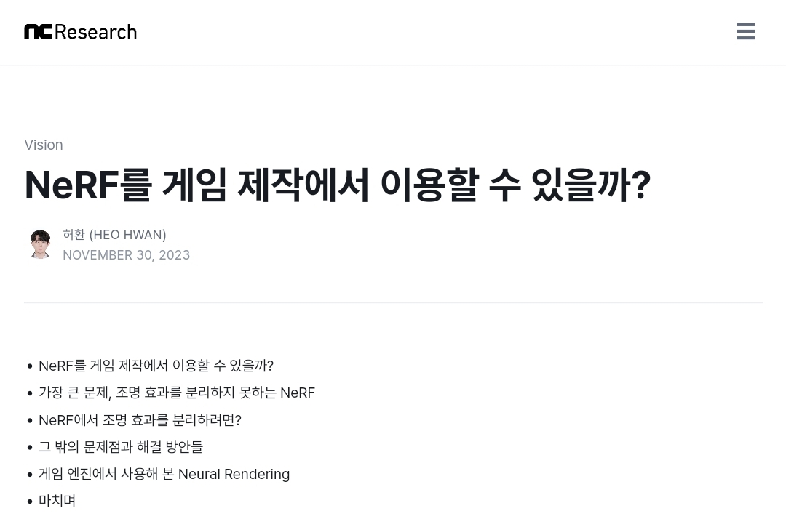
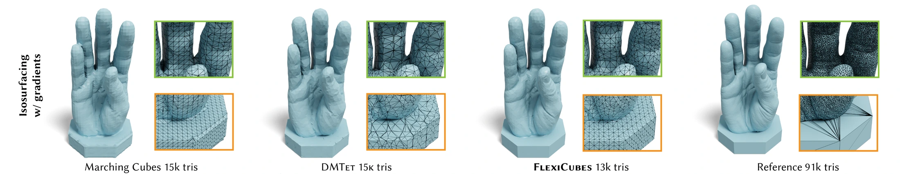

> 2024년 3월 8일에 쓴 글이다. 아래의 기술 평가와 전망은 당시의 상황과 생각을 담고 있다.

[(글 링크!!. 그림을 클릭해도 이어집니다)](/blogs/posts/can-nerf-be-used-in-game-kor/)
NCSoft Vision AI Lab 에 재직하면서 작년에 진행했던 프로젝트의 결과물 몇 개를 망라해 쓴 블로그 글이다.

해당 글에서는 NeRF, 3D Gaussian Splatting 등을 실제 게임 등에서 이용하려면 해결해야할 문제들에 대해 대표적으로

1. Relighting
2. Game Engine 에 NeRF/3D GS 결과물 이식

두 개를 꼽은 뒤, 각각에 대한 해결 방안이 현재 기술 수준에서 어떻게 되는지를 서술하였다. 글을 쓴지는 시간이 좀 흘렀는데, 같은 주제에 대한 짧은 생각과 업계 상황을 덧붙이려 한다.

## 1. NeRF와 Relighting

NeRF 초창기부터 relighting 문제는 BRDF 나 radiosity 등을 NeRF 와 함께 배우는 식으로 해결하려고 하고 있다.
$$ L_o (x, w_o) = \int_{\Omega} L_i (x, w_i ) f_{\text{BRDF}} (x,w_i, w_o ) (w_i \cdot n) dw_i \\ \text{where} \  w_0: \text{outgoing}, \ w_i:\text{incoming}, \ n:\text{normal}
$$
하지만 NeRF 나 3D GS 를 학습하는 동시에 팔자 좋게 rendering equation 으로 가능한 모든 outgoing / incoming reflection 을 계산하여 BRDF parameters 를 구하는 것은 실로 불가능에 가깝다.

따라서 대게의 조명 분리 방법 들은 light condition 을 극도로 단순화하거나, rendering equation 을 계산하는데 있어서 1번 이상의 reflection 은 계산하지 않는 등의 constraint 로 문제를 완화하려 한다.

당연히 SOTA method ([Relightable 3D Gaussian](https://nju-3dv.github.io/projects/Relightable3DGaussian/) 등) 들조차 아직 제대로 specular diffuse 를 분리하기는 멀었으며, 특히 shading 등을 해결하는데는 어려움을 겪는다.

당시 공유한 영상에서도 분리한 specular <-> diffuse 의 모습을 보여주었지만,

    <iframe src="https://www.youtube.com/embed/mV8CMTjB6dY?si=g6utbyt6CS5HKzZC" title="NeRF의 diffuse와 specular 분리" loading="lazy" allow="accelerometer; autoplay; clipboard-write; encrypted-media; gyroscope; picture-in-picture; web-share" referrerpolicy="strict-origin-when-cross-origin" allowfullscreen></iframe>

퀄리티 높은 BRDF 자체가 엔진, 게임 회사들의 자산과도 같은 것이기 때문에, 간단한 수준의 BRDF 식을 modeling 해서 학습하는 현재의 방법으로는 복잡한 environment light map 을 잘 복원하는 것이 요원하다.

## 2. NeRF와 Game Engine

태생 자체가 Rendering Equation 의 optimal solution 을 (적어도 well approximated one) 구하는 것과 밀접한 관련이 있는 relighting 과는 다르게, 그나마 Game Engine 으로의 이식은 사정이 좋은 편이다.

그전에 분명히 명시할 것이 있는데,
- 원 블로그 글에서 보여준 영상들 중 아래 영상은 NeRF Object 를 Blender 에서 이용한 것이며,

    <iframe src="https://www.youtube.com/embed/6BnlkMNlezM?si=RmCW8G_gO3WFA3GZ" title="Blender에서 사용한 NeRF 오브젝트" loading="lazy" allow="accelerometer; autoplay; clipboard-write; encrypted-media; gyroscope; picture-in-picture; web-share" referrerpolicy="strict-origin-when-cross-origin" allowfullscreen></iframe>

- 그 외에 Unity 에서 게임처럼 만들어 본 아래 장면에서 사용된 배경은

    <iframe src="https://www.youtube.com/embed/3OqbvUaoNFw?si=CZI80K6zNkV5sCYH" title="Unity에서 사용한 3D Gaussian Splatting 장면" loading="lazy" allow="accelerometer; autoplay; clipboard-write; encrypted-media; gyroscope; picture-in-picture; web-share" referrerpolicy="strict-origin-when-cross-origin" allowfullscreen></iframe>

- 360도 카메라를 이용해서 촬영한 공간을 ***3D Gaussian Splatting*** 을 통해 복원된 scene 이다.

    <iframe src="https://www.youtube.com/embed/ISm-IL3HzmM?si=J9sg2bePdJ6bao-j" title="360도 촬영에서 복원한 장면" loading="lazy" allow="accelerometer; autoplay; clipboard-write; encrypted-media; gyroscope; picture-in-picture; web-share" referrerpolicy="strict-origin-when-cross-origin" allowfullscreen></iframe>

이것을 명시한 이유는, ***게임 엔진에서 NeRF 를 지원하는 것과, 3D GS 를 지원하는 것의 난이도가 천차만별이기 때문이다.***

정의가 point cloud 의 변형에 가까운 3D GS는 rasterization 을 통해 scene 을 그리기 때문에 기존 game engine 에 이식하는 것이 그리 어렵지 않다. 일례로 프로젝트 진행하며 참고했었던 [Unity plugin](https://github.com/aras-p/UnityGaussianSplatting)이나, [Unreal Engine 3D GS plugin](https://www.unrealengine.com/marketplace/en-US/product/uegaussiansplatting-3d-gaussian-splatting-rendering-feature-for-ue) 등을 보면, NeRF 와는 다르게 3D GS 의 지원에는 game engine 관련된 종사자들이 적극적인 모습을 보여주는 것을 알 수 있다.

반면에 NeRF 로 학습된 Object 는 2D 로 rendering 하기 위해서는 원 NeRF 가 그러는 것처럼 ray casting 을 이용해 pixel 하나하나를 그려야 한다.
$$ C(r) = \int_{t_n}^{t_f} T(t) \cdot \sigma ({\rm \textbf{r}}(t))  \cdot c({\rm \textbf{r}}(t), {\rm \textbf{d}} ) \ dt \quad \text{where }T(t) = \text{exp} \bigg( - \int_{t_n}^{t}\sigma ({\rm \textbf{r}}(s)) ds \bigg )
$$

따라서 game engine 단에서는 이것을 지원하기보다는 (애초에 실시간 rendering 이 불가능에 가깝기 때문에 지원이 되어도 게임 제작에 쓸 수 있을 리가 없다) [Marching cube](https://en.wikipedia.org/wiki/Marching_cubes) 나 [DMTeT](https://research.nvidia.com/labs/toronto-ai/DMTet/) 등을 이용해서 polygonal mesh 로 만든 뒤, 이 mesh 에 texture 를 mapping 하여 obj 나 fbx 파일로 만들어서 사용한다.

문제는 아직 NeRF -> Mesh 로 만들어낸 object 가 사람이 만든 mesh 에 비해 너무 복잡한 형상을 지니거나, hole, crack 등이 생기고 texture 가 균등하지 않는 등 문제가 존재한다는 것이다. Neural Rendering 분야에 특화된 meshing 기법도 등장하고 있으나 ([flexicubes](https://research.nvidia.com/labs/toronto-ai/flexicubes/) 등) 아직은 NeRF object 를 game 에서 바로 사용할 quality 의 변환 성능이 나오지는 않는 모습이다. (*figure credit: flexicubes*)

그럼 그냥 위에서 언급한 것처럼
> "NeRF 쓰지 말고 3D GS만 사용하죠?"

라는 물음을 가질 수도 있을 법 한데, 3D GS도 algorithm 구조 상 확대/축소 했을 때 splat 이 보인다거나 NeRF 처럼 MLP 가 아니기 때문에 smoothing 해서 배워야 되는 부분도 과도하게 sharp 하다거나하는 문제가 있기 때문에 함부로 모든 경우에서 NeRF를 대체할 수 있는 수준이 아니다. 또한 3D GS 를 Mesh 로 변환하는 것은 NeRF 에서보다도 힘들어서, shortest scale axis 를 surface normal 로 가정하고 regularization 등을 추가하고, SDF 등과 같이 학습하는 방법이 제시되고는 있으나 아직은 실제로 쓰이기 요원한 수준이다.

## Conclusion?

결국 아직은 과도기이다. 마법처럼 신기술이 기존 기술을 대체할 것 같아 보이지만, 현업 단계에서 쓰이기에는 아직 quality 가 부족하다.

2D generation 도 처음 GAN 이 고퀄리티의 사람 사진을 만들어내고도 5~6년은 지난 다음에야, GAN이 아닌 Diffusion 을 통해서 상용화 할 수 있는 퀄리티로 성장하였다.

NeRF나 3D GS도 적어도 그 정도의 시간이, 어쩌면 diffusion 이 GAN 을 몰아낸 것처럼 다른 기술이 또 주류가 되어 서비스 단계에 접어들지 않을까하는 생각이 든다.

---

[Velog 원문](https://velog.io/@gjghks950/NeRF를-게임-제작에서-이용할-수-있을까에-대한-단상)
