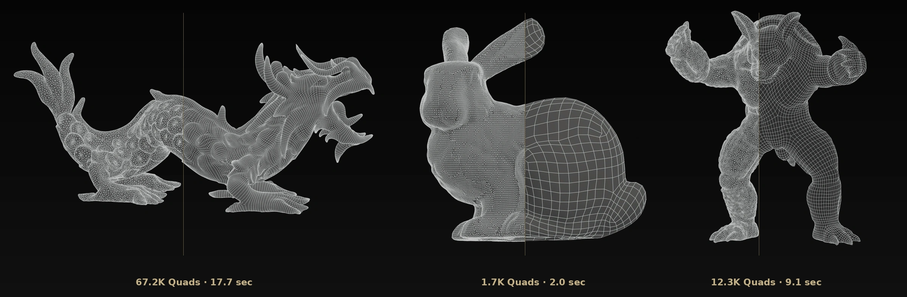
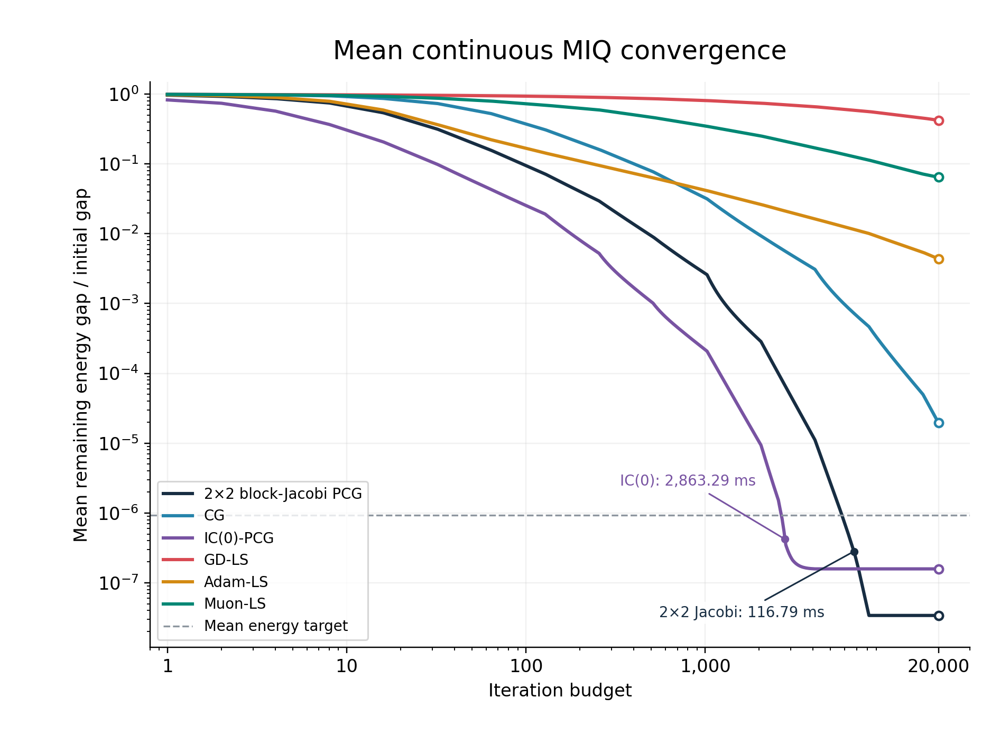
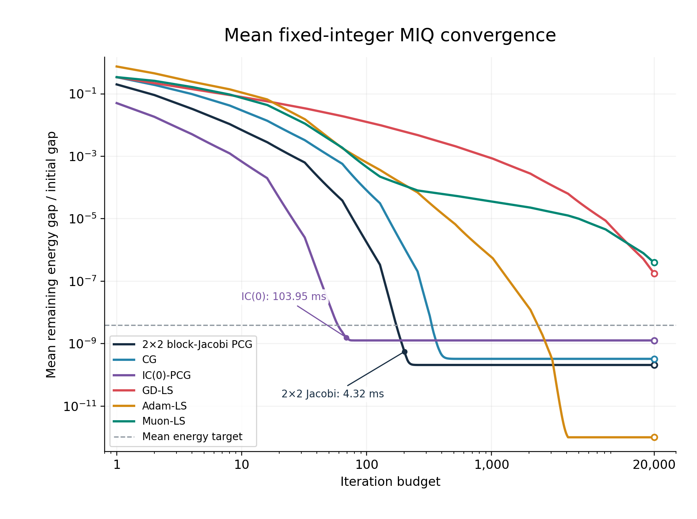
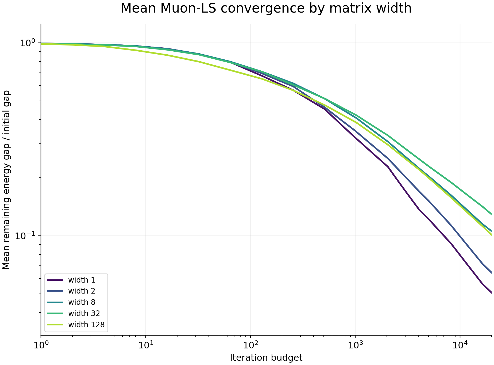

## Background: Quad Remeshing & DiT 

내가 올해 진행한 주요 연구 업무는 크게 두 가지였다. 

하나는 고품질의 Image-conditioned 3D Generative Model (DiT)을 학습하는 일이고, 다른 하나는 VARCO3D에 들어갈 고품질 quad remesher를 직접 개발하는 일이다. 
같은 3D 도메인을 다룬다는 점만 빼면 그래픽스 알고리즘과 생성 모델 학습은 구현 방식이나 참고하는 문헌이 사뭇 다르다.

그 중에서 Quad remesher에 대해 간략히 요약하자면, 입력 triangular mesh 위에서 사각형들이 정렬될 방향장(cross field)을 먼저 계산한 후, 이 방향장을 최대한 따르면서 일관되게 이어지는 *정수 좌표계*를 구한다.
이 문제는 구하려는 좌표계의 gradient 를 기존의 방향과 최대한 가깝게 만드는 Poisson 계열의 PDE로 볼 수 있지만, 
mesh surface의 연결 관계에 integer constraint이 들어가면서 혼합정수 최적화(Mixed-Integer Quadratic, MIQ) 문제가 된다. 

전체 과정은 이전 글 [Quad Remesh 톺아보기](/blogs/posts/quad-remesh-kor/)에서 자세히 다뤘다.

- GPU 가속 Quad Remesher 실행 결과 (좌: 입력 삼각형 메시, 우: 생성된 사각 메시 및 소요 시간)

일반적으로 NP-hard인 miq를 풀기 위해, 실무 구현에서는 모든 정수 조합을 탐색하는 대신 연속해를 먼저 구하고, 정수화할 변수를 골라 고정한 뒤 남은 변수의 에너지를 다시 최소화하는 **relax-and-fix** 방식을 GPU위에서 가속화하는 방법을 사용한다. 
정수 선택과 연속 최적화를 번갈아 수행하는 근사 해법이다. 

이 연산을 CUDA로 가속화하면서 단순 병렬화뿐만 아니라, 어떤 수치해법으로 몇 번의 iteration 만에 목표 정확도에 도달할 것인가가 중요해졌다. 
여러 구성을 비교한 끝에 실제로 가장 빨랐던 2×2 block-Jacobi PCG (Preconditioned Conjugate Gradient)를 기본 solver로 채택해 쓰고 있다.

한편, 3D 생성 모델의 DiT 학습에서는 matrix-valued 파라미터에 Muon optimizer를 적용하는 실험을 해보고 있었다. 
Muon을 사용할 땐 non matrix-valued parameter를 위해 AdamW 등의 optimizer를 사용해야하고, 
익숙하게 사용하던 AdamW와 비교해선 사용하기 위해 직접 kernel 최적화를 진행해야 update 속도가 개선되는 등 신경써야할 부분이 많았다. 

이런 Muon의 수식과 기전을 자세히 뜯어보다가, 문득 quad remesher에서 다루던 CG계열 수식들의 직관과 비슷하다는 생각이 들었다. 
PCG도, Muon도 모두 gradient 를 그대로 사용하지 않고 일종의 '좌표 변환'을 통해 update를 안정화 & 가속화하려는 기법이다. 

> 그렇다면 수치해석의 preconditioner와 딥러닝의 optimizer 설계는 본질적으로 비슷한 역할을 하는 것 아닐까? 만약 같은 이차함수를 풀게 한다면 어떻게 동작할까? Muon/Adam을 이용한 Quadremeshing 도 가능한가?

---

## 1. Quadratic Objective & Conjugate Gradient

간단한 이차 목적함수에서 출발해 보자. 행렬 $H$가 Symmetric Positive Definite (SPD)라고 가정할 때, 목적함수와 gradient, 최적성 조건은 다음과 같다.

$$
f(x)=\frac12x^\top Hx-b^\top x
$$
$$
g(x)=Hx-b,\qquad Hx^*=b
$$

Gradient Descent (GD)는 현재 gradient의 반대 방향으로 이동한다. 
$$x_{k+1}=x_k-\eta g_k$$
동일한 Euclidean 거리만큼 이동할 때 함수의 1차 근사를 가장 크게 줄이는 방향이지만, 축마다 곡률이 다르면 비효율적으로 동작한다. 

예를 들어 $$f(x_1,x_2)=50x_1^2+\frac12x_2^2$$에서는 \(x_1\) 방향의 곡률이 \(x_2\)보다 100배 크다. 
곡률이 큰 방향에서 발산하지 않도록 step size를 줄이면 완만한 방향에서의 수렴이 극도로 느려진다.

매 스텝 gradient 방향의 최적 이동 거리를 구하는 exact line search를 써도 이 문제는 해결되지 않는다. 
Line search를 하면 다음 위치의 gradient는 이전 탐색 방향과 직교하지만, 이후의 이동이 이전 방향에서 달성한 최적성을 계속 보존해 주지는 못하기 때문이다. 
좁고 긴 타원형 등고선에서 지그재그로 이동하는 현상이 발생하는 이유이며, 
이는 곡률의 불균형을 나타내는 condition number $\kappa(H)={\lambda_{\max}(H)}/{\lambda_{\min}(H)}$에 의해 결정된다. 

### H-Conjugacy: History Preservation

Conjugate Gradient(CG)는 탐색 방향들 사이에 Euclidean 직교성이 아닌, 목적함수의 곡률$(H)$을 반영한 내적에서의 직교성을 요구한다. 이를 **$H$-conjugacy** 라고 한다.

$$
p_i^\top Hp_j=0\qquad(i\ne j)
$$

현재 위치 $x$가 이미 $p_i$ 방향으로 최적화되어 있다면 $p_i^\top g(x)=0$을 만족한다. 여기서 새로운 방향 $p_j$로 이동했을 때, 기존 $p_i$ 방향의 gradient 성분을 계산해 보면 다음과 같다.

$$
p_i^\top g(x+\alpha p_j)
=
\underbrace{p_i^\top g(x)}_{0}
+
\alpha\underbrace{p_i^\top Hp_j}_{0}
=0
$$

즉, $H$-conjugate를 만족하는 새로운 방향으로 이동하면 이전에 최적화해 둔 방향의 최적성이 깨지지 않고 그대로 유지된다. 
CG는 이 성질을 이용해 탐색 공간을 확장해 나간다. 

Residual을 다음과 같이 두면,

$$
r_k=b-Hx_k=-g_k
$$

초기 방향 $p_0=r_0$로부터 다음과 같은 짧은 점화식만으로 계산이 이루어진다.

$$
\begin{aligned}
x_{k+1}&=x_k+\alpha_kp_k,
&
\alpha_k&=\frac{r_k^\top r_k}{p_k^\top Hp_k},\\
r_{k+1}&=r_k-\alpha_kHp_k,\\
p_{k+1}&=r_{k+1}+\beta_kp_k,
&
\beta_k&=\frac{r_{k+1}^\top r_{k+1}}{r_k^\top r_k}.
\end{aligned}
$$

고정된 SPD 이차함수와 오차 없는 산술 연산을 전제할 때, CG는 최대 변수 차원만큼의 iteration 안에 정확한 해에 도달한다. 
물론 실제 부동소수점 연산에서는 반올림 오차로 인해 직교성과 conjugacy가 조금씩 손실되므로 이론적인 유한 단계 수렴을 그대로 기대할 수는 없다. 

구현 관점에서 CG의 장점은 Hessian의 역행렬을 구할 필요 없이 매 스텝 $Hp_k$라는 Sparse Matrix-Vector Multiplication (SpMV) 한 번으로 곡률 정보를 활용한다는 점이다. 
내가 CUDA에서 최적화하던 핵심 연산도 바로 이 SpMV였다.

현재 방향에 이전 방향$(p_k)$을 섞는다는 점에서 딥러닝의 momentum과 닮아 보이지만, 
일반적인 momentum이 고정된 계수로 과거 gradient를 누적하는 것과 달리 CG의 계수 $\beta_k$는 이전 방향과의 conjugacy를 엄밀하게 유지하도록 매번 다시 계산된다는 차이가 있다.

---

## 2. Preconditioning: Geometry of Norm

CG가 탐색 방향을 효율적으로 고르더라도, Hessian의 eigenvalue 분포가 불리하면 여전히 수렴이 느려진다. 
이때 사용할 수 있는 방법이 **좌표계 자체를 변환하는 preconditioning** 이다. 

$H$를 근사하는 SPD 행렬 $M$을 도입해 
$$x=M^{-1/2}y$$
로 좌표를 변환하면, 새로운 좌표계에서의 Hessian은 다음과 같이 바뀐다.
$$
\widetilde H=M^{-1/2}HM^{-1/2}
$$

이상적으로 $M=H$라면 $\widetilde H=I$가 되어 모든 방향의 곡률이 같아진다. 
즉, 수렴에 불리한 길쭉한 타원형 objective geometry 에서, 수렴에 유리한 구형 objective geometry가 된 것이다. 

실제로는 $H^{-1}$을 구하는 비용이 너무 크므로, 적용 비용이 저렴하면서도 $\widetilde H$의 곡률 불균형을 충분히 줄여주는 $M$을 찾는 것이 목표가 된다. 
PCG는 이렇게 좌표 변환된 문제에 CG를 적용하는 알고리즘이다.

다른 관점에서 preconditioning을 바라보면, 업데이트 크기를 재는 거리 기준(metric)을 Euclidean norm 에서 $M$-norm 으로 바꾼 상태에서  
$$\|\Delta x\|_M^2=\Delta x^\top M\Delta x$$
1차 근사 함수를 최소화하는 것으로도 해석할 수 있다.
$$
\Delta x^*
=
\arg\min_{\Delta x}
\left[
g^\top\Delta x+
\frac{1}{2\eta}\Delta x^\top M\Delta x
\right]
=
-\eta M^{-1}g
$$

즉, '*가장 가파른 방향(steepest descent)*'은 순간의 기울기 방향만으로 결정되는 것이 아니라, 어떤 geometry를 기준으로 이 값을 측정할지에 따라 달라진다. 

표준 PCG는 이 변환을 residual에 적용하여 $z_k=M^{-1}r_k$를 구하고 다음과 같이 업데이트한다. 
$$
p_{k+1}=z_{k+1}+\beta_kp_k, \qquad
\alpha_k=\frac{r_k^\top z_k}{p_k^\top Hp_k}, \qquad
\beta_k=\frac{r_{k+1}^\top z_{k+1}}{r_k^\top z_k}
$$

### 2×2 Block-Jacobi vs. Incomplete Cholesky (IC)

Remesher에서 사용하던 2×2 block-Jacobi는 Hessian에서 결합이 강한 변수 두 개씩을 묶어 부분 행렬을 만든다. 
선택한 변수쌍의 인덱스를 $B_i$라고 할 때, 각 diagonal 블록은 다음과 같다.
$$
H[B_i,B_i]
=
\begin{pmatrix}
a_i&c_i\\
c_i&b_i
\end{pmatrix}
$$
대각 성분만 쓰는 scalar Jacobi와 달리 두 변수 사이의 교차항 $c_i$까지 반영한다. 
블록 바깥의 결합은 무시하지만, 각 2×2 블록의 역행렬을 완벽히 독립적으로 계산할 수 있어 GPU 병렬화에 매우 유리하다.

반면 Incomplete Cholesky(IC)는 $H\approx LL^\top$ 형태의 sparse 근사 분해를 만든다. 더 넓은 범위의 변수 결합을 반영하므로 수렴에 필요한 iteration 수를 크게 줄일 수 있다. 
하지만 매 스텝 preconditioner를 적용$(z_k = M^{-1}r_k)$할 때마다 다음 두 번의 triangular solve (SpSV)를 수행해야 한다.
$$
Ly=r,\qquad L^\top z=y
$$
삼각행렬 풀이에는 본질적으로 이전 변수의 결과가 나와야 다음 변수를 풀 수 있는 순차적 계산 의존성이 존재하며, 달성 가능한 병렬성도 행렬의 희소 패턴에 크게 좌우된다. [NVIDIA Docs](https://docs.nvidia.com/cuda/archive/12.8.1/incomplete-lu-cholesky/index.html) 

결국 수치해법의 전체 속도는 **수렴에 필요한 iteration 수**와 **1회 iteration당 계산 비용**의 곱으로 결정되며, 이 트레이드오프가 뒤이어 다룰 실험 결과에 그대로 나타났다.

## 3. Adam and Muon Optimizer

딥러닝 optimizer들도 gradient를 그대로 쓰지 않고 변형하지만, 변환 행렬을 만들 때 참조하는 정보가 수치해석의 preconditioner와는 다르다.

### Adam: Gradient-based Diagonal Scaling

Adam은 gradient의 1차 및 2차 moment를 exponential moving average (EMA)로 추정한다.
$$
m_t=\beta_1m_{t-1}+(1-\beta_1)g_t, \qquad
v_t=\beta_2v_{t-1}+(1-\beta_2)g_t^{\odot2}
$$

Bias 보정을 거친 $\hat m_t, \hat v_t$를 이용한 업데이트 식 
$$\Delta x_t = -\eta \frac{\hat m_t}{\sqrt{\hat v_t}+\epsilon}$$
에서 분모를 diagonal matrix $D_t$로 표기하면 
$$\Delta x_t=-\eta D_t^{-1}\hat m_t$$
가 된다. 
형태만 보면 **adaptive diagonal preconditioning이 결합된 momentum** 이다. 

그러나 실제 Hessian의 diagonal 성분을 가져다 쓰는 Jacobi PCG와 달리, Adam은 그동안 지나온 경로에서 관측된 gradient 제곱의 평균을 사용한다. 
Gradient의 크기를 평균 냈다고 해서 objective의 Hessian이 구해지는 것은 아니다. 
특히 이번 실험처럼 노이즈가 없는 deterministic 이차함수를 풀 때는 $g(x)=Hx-b$가 정확히 주어지므로, Adam의 $v_t$는 순전히 초기점으로부터 어떤 궤적을 따라 이동했는지에 종속된다.

### Muon: Steepest Descent on Spectral Norm

Muon은 2차원 행렬 형태의 파라미터를 대상으로 한다. Momentum과 Nesterov 조합으로 얻은 행렬을 $B_t$라고 할 때, 
이상적인 Muon은 SVD 기준으로 positive singular value들을 모두 1로 만드는 orthogonalization (정확히는 polar decomposition의 orthogonal factor 추출)를 수행한다.
$$
B_t=U_r\Sigma_rV_r^\top
\quad\Longrightarrow\quad
Q_t=U_rV_r^\top
$$

실제 구현에서는 무거운 SVD를 매번 돌리는 대신 Newton–Schulz 반복법을 통해 이 변환을 다항식으로 근사한다 (소수의 반복으로 update를 얻으며, 결과가 정확한 polar factor와 일치한다고 보장하지는 않는다). 

이 연산의 기하학적 의미 또한 거리 기준(norm)의 변화로 설명할 수 있다. 
Momentum을 잠시 빼고 현재 gradient 행렬을 $G$라고 할 때, 행렬의 maximum singular value인 spectral norm $\|\cdot\|_2$ 제약하에서 linear approximation 손실을 최소화하는 문제를 생각해 보자.
$$
\min_{\|\Delta W\|_2\leq\eta}
\langle G,\Delta W\rangle
\quad\Longrightarrow\quad
\Delta W^*=-\eta U_rV_r^\top
$$
즉, Muon의 직교화는 **spectral norm 기준의 steepest descent** 방향을 구하는 과정이다. 

Linear 레이어 $y=Wa$ 에서 가중치 변화에 따른 출력 변화량이 
$$\|\Delta W a\|_2 \leq \|\Delta W\|_2\|a\|_2$$
를 만족하므로, 파라미터를 단순한 1차원 벡터가 아니라 입출력을 매핑하는 연산자로 보고 출력 변화를 제어하겠다는 설계다. 

- 이처럼 optimizer를 특정 norm에서의 steepest descent로 해석하는 관점은 *Old Optimizer, New Norm* 등의 연구에서도 잘 정리되어 있다. [arXiv](https://arxiv.org/abs/2409.20325)
- [jeremybernste's muon derivation](https://jeremybernste.in/writing/deriving-muon) 

이제 PCG와 Muon 사이의 연결과 차이가 함께 보인다.
PCG와 Muon은 모두 움직임의 기준(metric)을 바꾸지만 대상이 다르다. 
PCG는 objective function **Hessian의 eigenvalue spectrum**을 평탄화하려 하고, Muon은 **update matrix 자체의 singular spectrum**을 평탄화한다.

이 둘을 비슷하다고 느낀 것이 이 글의 출발점이었다.  

---

## 4. Experiments: DL Optimizer in Quad Remeshing

이론을 정리한 후에 남은 궁금증은 "Quad Remeshing의 MIQ 풀이에서도 Muon/Adam을 쓸 수 있는가" 였다. 
이에 대한 실제 실험을 진행하면서 수렴 거동과 하드웨어에서의 실제 계산 비용을 비교해 보았다.

실제 remeshing 문제에서 추출한 행렬 위에서 GD, CG, 2×2 block-Jacobi PCG, IC(0)-PCG, Adam, Muon 여섯 가지를 비교했다. 
순수 quadratic solver 성능만 비교하기 위해서 다른 모든 조건은 고정하고 MIQ energy minimization에 대해서만 측정했다. 
환경은 NVIDIA B300 GPU이며 모든 연산은 FP64로 통일했다. 

### DL Optimizer w/ Line Search 

딥러닝 optimizer들을 고정된 learning rate로 돌리면 튜닝 여부에 따라 결과가 크게 왜곡될 수 있다. 

각 알고리즘이 만들어내는 **탐색 방향의 품질**만 공정하게 비교하기 위해, GD, Adam, Muon 모두에 exact quadratic line search를 결합했다 (실험에서는 **GD-LS, Adam-LS, Muon-LS**로 표기). 
$$
x_{\mathrm{new}}=x+\alpha^* d,
\qquad
\alpha^*=-\frac{g^\top d}{d^\top Hd}
$$

Adam은 momentum 추정을 그대로 유지했고, Muon은 momentum 0.95, Nesterov, 5-step Newton–Schulz를 사용하되 weight decay는 껐다. 
만약 momentum이 섞인 방향이 descent direction이 아닐 경우 해당 스텝은 residual 방향으로 대체하고 momentum 버퍼를 초기화하도록 처리했다. 

- 참고로 momentum이 없는 이상적인 Muon $(Q=\operatorname{Polar}(G)) $에 line search를 적용하면, 분자가 nuclear norm $\|G\|_*$가 되어 $\alpha^* = \frac{\|G\|_*}{\langle Q,\mathcal H[Q]\rangle}$ 형태를 띤다. 물론 이렇게 최적 거리를 이동하더라도 CG와 같은 conjugacy가 생기는 것은 아니다.

### Evaluation Criteria

공정한 비교를 위해 두 가지 설정을 분리했다.
1. **Continuous relaxation:** 초기 연속 최적화 단계만 동일하게 재생.
2. **동일 integer assignment 고정:** 기본 solver가 최종적으로 선택한 정수 배정을 그대로 고정해 두고, 모든 free coordinate (자유 변수)를 0으로 초기화한 뒤 단일 quadratic을 푸는 설정.

실제 remeshing 목적함수가 얼마나 줄어드는지 비교하기 위해, 수렴 판정에는 physical energy를 사용했다. 
기본 solver가 도달한 에너지를 $E_{\mathrm{ref}}$라 할 때, 다음 조건에 도달하는 iteration 수와 시간을 측정했다.
$$
E\leq E_{\mathrm{ref}}
+10^{-5}\max(|E_{\mathrm{ref}}|,1)
$$
여기서 에너지는 순수 least-squares 항으로만 계산하고 수치적 안정성을 위해 더해진 gauge 항은 제외했다 (따라서 이 기준은 엄밀한 최적해 오차나 동일 residual 도달 여부와는 다르다). 

또한 이론 설명에서는 SPD를 가정했으나 실제 추출된 시스템에는 완전히 0으로 마스킹된 좌표들이 포함되어 있어 전체 행렬은 PSD (Positive Semi-Definite)다. 
실험은 유효 부분공간 (compatible RHS) 위에서 문제없이 수행되었다. 

---

## 5. Results

### IC(0)-PCG vs. Block-Jacobi PCG

먼저 정수 배정을 고정한 문제에서 목표 에너지에 도달하기까지 걸린 평균 iteration 수와 실행 시간은 다음과 같다. 

| 2×2 block-Jacobi PCG | IC(0)-PCG |
|---:|---:|
| 142회 / **4.318 ms** | **49회** / 103.946 ms |

IC(0)는 예상대로 수렴에 필요한 iteration 수를 약 **3배 줄였다.** 하지만 실제 GPU 경과 시간은 오히려 **24배 더 오래 걸렸다.**

전처리 행렬을 만드는 factorization 비용은 이미 측정에서 제외한 상태다. 커널 프로파일링을 해보니, 매 iteration마다 수행되는 두 번의 triangle solve (cuSPARSE SpSV)가 GPU 실행 시간의 대부분을 잡아먹고 있었다. 
더 넓은 결합 정보를 반영해 스텝 수를 줄였지만, 그 정보를 적용할 때 발생하는 순차적 의존성 때문에 *GPU의 병렬 자원을 제대로 활용하지 못한 것*이다. 반면 2×2 block-Jacobi는 스텝 수는 더 필요해도 각 스텝이 가볍고 완전히 병렬화되어 전체 시간에서 압도적으로 유리했다.

- 물론 이는 natural ordering 상태의 IC(0)와 현재 cuSPARSE 구현에 국한된 결과이며, coloring 기법이나 다른 재배열을 쓰면 양상이 달라질 수 있다.

### Convergence Rate of GD, Adam, Muon

최대 20,000 iteration의 예산을 주었을 때 목표 에너지에 도달한 비율은 다음과 같다 (미도달은 발산이 아니라 예산 내 수렴 실패를 뜻한다). 

| Method | continuous relaxation | 동일 integer assignment 고정 |
|---|---:|---:|
| CG | 79% |  100% |
| 2×2 block-Jacobi PCG | 100% | 100% |
| IC(0)-PCG | 100% |  100% |
| GD-LS | **0%** | **53%** |
| Adam-LS | **0%** | 100% |
| Muon-LS | **0%**  | **21%** |

정수 배정을 고정한 비교적 쉬운 문제에서 Adam-LS는 모든 케이스에서 목표에 도달했으나 block-Jacobi보다 **8.6~25.8배 느렸다.** 
Muon-LS는 가장 작은 범위의 MIQ 세팅에서만 수렴했고, 나머지 케이스에서는 20,000번을 다 채우고도 목표에 도달하지 못했다. 

| Continuous Relaxation | Fixed Integer Assignment  | 
|---|---|
|   |  |

Muon이 고전한 이유는 매 스텝 Newton–Schulz 반복을 도는 계산 비용 때문만이 아니다. 
수렴에 필요한 iteration 수 자체가 너무 많았다. 

확률적 노이즈가 크고 Hessian을 명시적으로 쓸 수 없는 딥러닝 환경과 달리, 
정확한 Hessian이 주어지고 높은 정밀도로 해를 구해야 하는 sparse quadratic problem에서는 업데이트 행렬의 singular value를 고르게 만드는 전략이 PCG의 conjugacy 및 curvature 보정을 대체하지 못했다.

---

## 6. Muon Reshaping

실험 과정에서 짚고 넘어가야 할 부분이 하나 더 있었다. DiT의 linear layer는 입출력 차원이라는 명확한 2차원 행렬 구조를 가지지만, remesher의 변수는 1차원 벡터다. 
Muon을 적용하려면 이 벡터를 어떤 형태로든 2차원 행렬로 reshape 해야한다.
처음에는 기존 변수 순서를 그대로 둔 채 행렬의 width을 1, 2, 8, 32, 128로 바꿔가며 실험했다 (남는 칸은 0으로 패딩 후 업데이트 뒤 복원). 

<figure class="post-media">
    
    <figcaption>행렬 폭(1, 2, 8, 32, 128)에 따른 Muon-LS의 평균 수렴 곡선. 세로축은 초기 energy gap으로 정규화한 남은 energy gap의 평균이다.</figcaption>
</figure>

하지만 행렬의 폭을 키운다고 해서 수렴이 빨라지는 경향은 없었고, 오히려 후반부에는 width 1이 더 낮은 에너지를 기록하기도 했다. 
- 참고로 여기서의 width 1은 벡터 전체를 정규화하는 형태라 exact line search를 거치면 스케일링 효과가 상쇄되지만, 내부에 momentum과 Nesterov가 남아 있어 순수 GD-LS와는 다른 궤적을 그린다 (momentum을 완전히 뺀 이상적인 polar-LS의 width 1은 GD-LS와 정확히 일치한다). 

### Physical UV pair vs. Hessian

> 임의로 벡터를 자르는 대신 문제의 기하학적 의미를 살려 행렬을 구성하면 어떨까? 

Remeshing 변수는 각 정점의 2차원 coordinate map인 $(u_i, v_i)$에서 유래한다. 
데이터 인덱스를 추적해 활성 변수의 약 93~99%를 실제 같은 정점에 속한 $(u_i, v_i)$ 쌍으로 복원한 뒤, 이를 $N\times 2$ 행렬로 묶어 Muon을 다시 돌려보았다.

그러나 물리적 의미를 살린 UV pairing 역시 기존 임의의 width 2 구성보다 나은 성능을 보이지 못했다. 

원인을 파악하기 위해 Hessian 행렬의 내부 값들을 직접 찍어보다가 흥미로운 사실을 발견했다. 
복원한 실제 $(u_i, v_i)$ 쌍에 대응하는 Hessian의 $2\times 2$ diagonal 블록을 추출해 보니 교차항이 전부 0이었다.
$$
H[\{u_i,v_i\},\{u_i,v_i\}]
=
\begin{pmatrix}
a_i&0\\
0&b_i
\end{pmatrix}
$$
동일 정점의 $u_i$와 $v_i$ 사이에는 직접적인 교차항이 없었던 것이다 (물론 전체 U 변수군과 V 변수군 사이의 경계 조건 등 다른 결합까지 없다는 뜻은 아니다). 

만약 이 물리적 UV 쌍을 기준으로 2×2 block-Jacobi를 짰다면 교차항이 0이므로 scalar Jacobi과 완전히 똑같이 동작했을 것이다.
반면 기존 solver의 2×2 block-Jacobi 루틴은 변수의 물리적 의미와 무관하게 **실제 Hessian 행렬에서 비대각 원소$(c_i)$의 크기가 큰 변수쌍**을 greedy하게 찾아 묶어 준다. 
물리적으로 한 쌍인 변수와 수치적으로 강하게 결합된 변수가 달랐던 셈이다.

### Muon's Gram Matrix

더 나아가, 설령 교차항이 있었다 하더라도 block-Jacobi와 width 2 Muon이 다루는 $2\times 2$ 행렬은 전혀 다른 정보다. 

$N\times 2$ 크기의 gradient 행렬 $G$에 대해 이상적인 polar 변환 
$$Q=G(G^\top G)^{-1/2}$$
를 생각하면, 여기서 역제곱근을 취하는 대상은 다음과 같은 전역 Gram matrix다.

$$
G^\top G
=
\begin{pmatrix}
\sum_i g_{u_i}^2 & \sum_i g_{u_i}g_{v_i}\\
\sum_i g_{u_i}g_{v_i} & \sum_i g_{v_i}^2
\end{pmatrix}
$$

Block-Jacobi가 각 지역 변수쌍의 국소 curvature $H[B_i,B_i]$를 개별적으로 역변환하는 반면, Muon은 모든 정점의 gradient를 다 합산한 전역적인 축 간 상관관계를 정규화한다. 
똑같이 $2\times 2$ 행렬 연산을 수행하더라도 보정하는 대상 자체가 다르다.

---

## 정리하며

수학적으로 아름답고 엄밀한 알고리즘을 보면 자연스럽게 끌린다. 
명쾌한 가설과 그럴듯한 이론적 근거가 있다면 좋은 결과를 기대하기 마련이다. 
이번에도 IC는 block-Jacobi보다 변수 사이의 결합을 더 많이 반영하니 유리할 것 같았다. 
실제로 iteration은 크게 줄었다. 
그런데 GPU에서 그 보정을 적용하는 비용까지 계산하면, 단순한 2×2 block-Jacobi가 훨씬 빨랐다. 
수렴이 좋아진다는 예상은 맞았지만, 그것이 내가 필요한 속도 개선으로 이어지지는 않았다.

Muon도 비슷했다. 
처음에는 Block-Jacobi처럼 행렬의 불균형을 보정하는 방법이라고 생각했고, 실제로 적용했을 때는 느리다는 결과를 얻었다. 
단순히 성능만 비교하고 끝냈다면 그 이유는 여전히 모른 채 넘어갔을 것이다. 
Hessian의 국소 블록과 전역 Gram matrix가 서로 다른 정보를 담는다는 점, 
같은 정점의 UV 쌍이 solver가 고르는 강한 결합 쌍과 다르다는 점까지 보고 나니 처음의 유사성을 어디까지 믿어도 되는지 알 수 있었다.

지난 몇 개월 동안 quad remesher를 개발하고 3D 생성 모델을 학습하면서, 
이론적으로 매력적인 아이디어를 실제 성능 개선으로 연결하는 것은 또 다른 문제라는 사실을 거듭 확인했다. 
좋은 가설도 실제 데이터와 하드웨어 위에서 검증해야 하고, 수렴률뿐 아니라 그 수렴률을 얻기 위해 지불하는 비용까지 살펴봐야 한다. 
IC(0)의 수렴률이 더 좋아도 GPU에서는 훨씬 느릴 수 있고, Muon의 결과가 기존에 쓰던 AdamW보다 안 좋을 수도 있다 (billion-scale image-to-3D 실험에서는 정성적 이득 없이 update만 느렸다).

실험과 구현이 간편해진 세상이다. 
그래서 요즘은 후보 하나를 오래 고민하기보다 직접 시험해보는 편이 낫다고 느낀다. 
그렇다고 이론적인 이해가 덜 중요해지는 것은 아니다. 오히려 반대라고 생각한다. 
느리다는 결과만으로 방법을 버릴지, 구현을 고칠지, 변수 묶음을 바꿔볼지 판단하려면 결국 수학과 데이터와 코드를 함께 봐야 한다. 
이번에도 IC에서는 triangular solve의 비용을, Muon에서는 행렬을 묶는 방식과 그 연산이 사용하는 정보를 따로 확인해야 했다. 
제한된 시간과 GPU 예산 안에서 다음 실험을 고르는 데에는, 그 과정에서 얻은 이해가 더 도움이 됐다.

끝으로, 연말 공개 예정인 billion-scale image-to-3D 모델의 생성 결과 하나를 덧붙인다.
처음부터 직접 학습 중인 모델로, 지금까지의 정성 비교에서는 TRELLIS.2보다 생성이 안정적이고 특히 입력 이미지와의 정합성이 훨씬 좋았다.

<figure class="post-media" data-generation-comparison>
    <picture>
        <source media="(max-width: 600px)" srcset="/blogs/posts/261022_pcg_muon/assets/image-to-3d-comparison-mobile.webp" width="704" height="2220">
        
    </picture>
    <figcaption><a href="/blogs/posts/261022_pcg_muon/assets/image-to-3d-input.webp">입력 이미지</a>, <a href="/blogs/posts/261022_pcg_muon/assets/image-to-3d-ours.webp">Ours</a>, <a href="/blogs/posts/261022_pcg_muon/assets/image-to-3d-trellis2.webp">TRELLIS.2</a> 순서의 정성 비교.</figcaption>
</figure>

